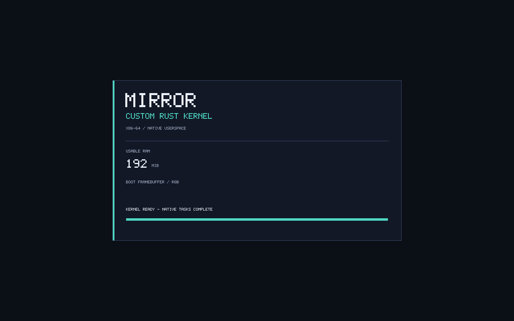
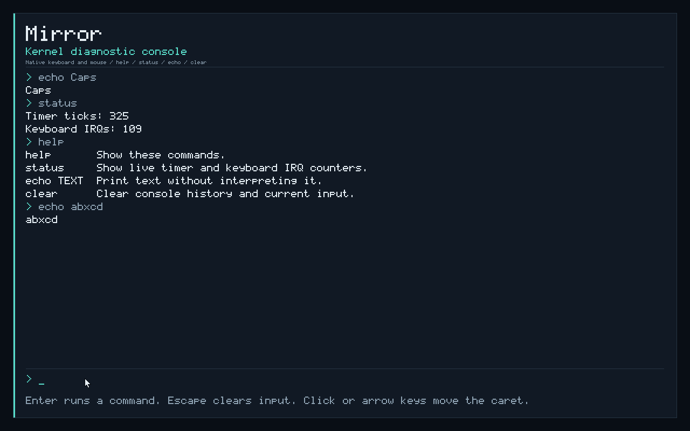
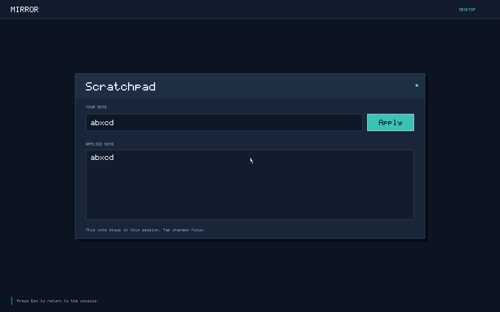
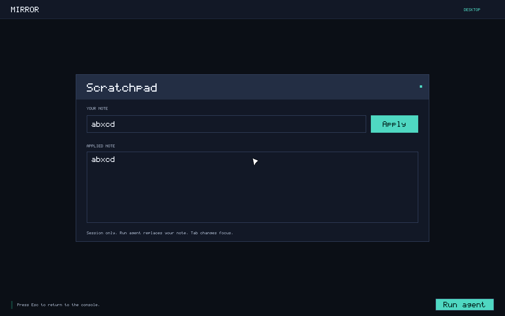
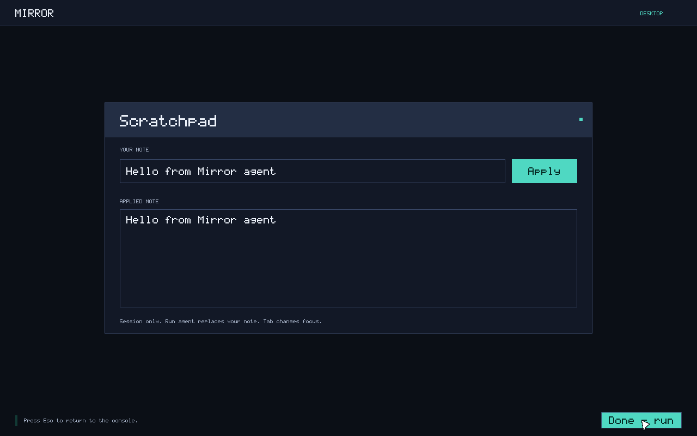
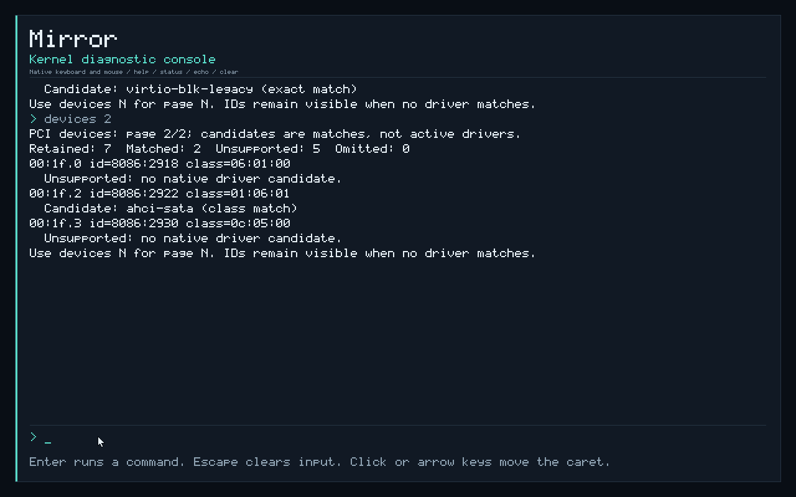

# Mirror

Mirror's goal is a full-fledged modern operating system, written in Rust wherever practical, with a complete native desktop and system services for people and AI agents. Mirror owns the system interfaces for processes, memory, scheduling, devices, and native services. Windows and Linux are application compatibility targets: separate compatibility implementations will translate their application interfaces onto Mirror. Other goals are fast and controllable automation and coordination of local inference with the rest of the system.

**Development priority:** build the kernel and native system foundations required by that complete operating system. Memory management, general processes and threads, scheduling, platform discovery, drivers, writable storage, filesystems, and persistent services come before agent features and further desktop demo polish. The current shell supplies integration coverage for processes, input, and composition; a modern desktop remains a substantial deliverable.

**Status:** the freestanding Rust kernel boots through UEFI/Limine in QEMU with private page tables, reusable physical pages, an explicitly growable kernel heap (1 MiB initially, 16 MiB maximum), ACPI topology discovery, xAPIC/IOAPIC interrupt routing with legacy PIC fallback, and secondary CPU startup with targeted interprocessor interrupts. Each secondary has private descriptors and a guarded kernel stack. A prepared 2 MiB kernel mapping window supports shared page insertion and removal, with synchronous TLB shootdowns requiring every target CPU's acknowledgement before a removed frame can be reclaimed. Userspace scheduling and device handling remain on the bootstrap CPU, which normally uses a calibrated local APIC timer at roughly 100 Hz with PIT fallback. An optional 64-bit HPET supplies monotonic elapsed time independently of delivered interrupts. The legacy VirtIO block driver supports sector reads, explicitly authorized writes, and cache flushes, with owned DMA and confirmed reset before reclamation. A vendor-independent AHCI SATA fallback adds read-only access to supported firmware-initialized disks. A bounded driver catalog and the diagnostic console expose hardware IDs and driver candidates. Anonymous memory supports reservation, demand-zero pages, protection changes, partial release, quotas, and accounting. The 35 native syscalls include thread creation, exit, join, explicit FS/GS bases for runtime-managed thread-local storage, process-private address waits and wakeups, and a nanosecond clock snapshot. Each process supports four thread slots sharing its address space and handles, with independent integer registers, x87/MMX/SSE state, FS/GS state, and blocking state. A Rust userspace mutex uses the address-wait foundation to block contending threads. Normal boot starts a bounded shell and up to two independent Notes or Counter processes, each with its own address space, offscreen surface, routed input, and recurring execution allowance. These are bootstrap implementations: general process/service management, broader synchronization, modern platform support, filesystems, persistence, and broader drivers remain unfinished. The earlier Scratchpad/agent experiment remains available through `-AgentDemo`; default boot starts no agent.

**Validation:** the AHCI fallback and driver-catalog changes pass all checks in the default `scripts/test.ps1` suite: 49 host unit tests, three compile-fail trait checks, formatting, normal/all-feature Clippy, 98 debug/release kernel/device smoke boots, and debug/release shell/application and fallback-console captures with four CPUs online. Both profiles cover AHCI sector reads without image changes, read-error recovery, failed-initialization cleanup and reopening, four-CPU AHCI startup, hardware-catalog matching, and console hardware-page navigation. Storage regressions cover authorized VirtIO sector writes and explicit flushes, whole-image persistence checks, write/flush error recovery, rejection without flush support, and dirty shutdown with DMA reclamation. Platform regressions cover one-, two-, four-, and eight-CPU APIC boots, local-timer calibration and preemption, explicit PIT selection, calibration-failure cleanup and PIT fallback, HPET progress with interrupts disabled, clock syscall copies, absent HPET and activation-failure cleanup, shared mapping visibility and frame reclamation, heap rollback and growth to the full 16 MiB limit, secondary stack-guard and unmapped-page fault isolation, fail-stop behavior on a missing shootdown acknowledgement, and forced PIC routing with one and four CPUs. The expanded init regression uses a finite 128-tick process budget; its previous 64-tick allowance could expire during ordinary debug checks. The deliberate budget-exhaustion case still requires exact termination, while service allowances remain 32/100 ticks. The strict manual `UserSimd` exception probe remains excluded because the development QEMU TCG does not deliver its unmasked SSE trap; hardware `#XM` delivery and physical hardware remain unvalidated. The suite uses 256 MiB fixtures; the full debug ELF encounters a Limine loader allocation failure at 128 MiB before kernel entry. Shell capture targets 1280 by 800 in QEMU.

## Build and boot the kernel

The kernel, native init, desktop shell, application executable, and optional agent target `x86_64-unknown-none` using stable Rust (declared minimum 1.88; latest validation uses 1.96.0). Dependency-free `no_std` crates define the [anonymous-memory ABI](crates/vm-protocol/src/lib.rs), [thread/TLS/address-wait ABI](crates/thread-protocol/src/lib.rs), [clock ABI](crates/clock-protocol/src/lib.rs), and [window protocol](crates/window-protocol/src/lib.rs). The [mirror-sync crate](crates/sync/src/lib.rs) supplies native wait/wake wrappers and a safe Rust mutex without an allocator. The separate [desktop protocol crate](crates/desktop-protocol/src/lib.rs) supports the optional agent experiment. Rustup installs the target and components declared in `rust-toolchain.toml`. Cargo dependencies are locked, Limine bindings are pinned to 0.5.0, and the build script downloads Limine v12.9.3 with pinned SHA-256 verification. `scripts/build.ps1` stages all five executables using their own linker settings and Rust's bundled linker; bare-metal builds require no host C linker. The workspace defaults to the kernel, so use that script to prepare a boot tree. Host tests target `x86_64-pc-windows-msvc` and require the MSVC linker and Windows SDK.

All four native userspace executables use the small code model for their low virtual addresses. Their optimized builds disable LTO to avoid merging incompatible code-model metadata with Rust's prebuilt `core`; kernel release LTO remains enabled. The current target still uses soft-float code generation in both kernel and userspace. Explicit assembly exercises the supported user x87/MMX/SSE state; enabling compiler-generated SIMD and a matching floating-point userspace ABI requires a dedicated userspace target and rebuilt `core`.

From the repository root in PowerShell:

```powershell
# Compile and stage the kernel, init, desktop shell, application, and optional agent.
.\scripts\build.ps1

# Run formatting, host tests, Clippy, 98 smoke cases, and shell/app/console captures.
.\scripts\test.ps1

# Build the smoke-test kernel, boot it, and verify its serial results and exit code.
.\scripts\run.ps1 -Smoke

# Verify the optimized kernel, including LTO.
.\scripts\run.ps1 -Smoke -Release

# Exercise the standard AHCI SATA path instead of the legacy VirtIO test disk.
.\scripts\run.ps1 -Smoke -AhciDisk
.\scripts\run.ps1 -Smoke -AhciDisk -Fault AhciIoError
.\scripts\run.ps1 -Smoke -AhciDisk -Fault AhciInitFailure
.\scripts\run.ps1 -Smoke -AhciDisk -CpuCount 4

# Run shared contracts, synchronization, and ACPI parser tests without QEMU.
cargo test --locked -p mirror-vm-protocol -p mirror-thread-protocol -p mirror-clock-protocol -p mirror-sync -p mirror-acpi -p mirror-window-protocol -p mirror-desktop-protocol --target x86_64-pc-windows-msvc

# Start four CPUs and verify targeted IPIs; userspace remains on the BSP.
.\scripts\run.ps1 -Smoke -CpuCount 4
.\scripts\run.ps1 -Smoke -ExtendedCpu -CpuCount 8

# Verify remote faults after unmapping and fail-stop on a missing shootdown ACK.
.\scripts\run.ps1 -Smoke -CpuCount 4 -Fault SmpUnmap
.\scripts\run.ps1 -Smoke -CpuCount 4 -Fault SmpTlbTimeout

# Keep ACPI discovery but force the PIC/PIT interrupt backend by boot policy.
.\scripts\run.ps1 -Smoke -LegacyPic

# Keep APIC routing and SMP, but use PIT timer interrupts.
.\scripts\run.ps1 -Smoke -CpuCount 4 -PitTimer

# Fail a running calibration counter and verify cleanup before PIT fallback.
.\scripts\run.ps1 -Smoke -CpuCount 4 -Fault TimerCalibration

# Remove HPET and verify the unavailable clock ABI with either IRQ backend.
.\scripts\run.ps1 -Smoke -CpuCount 4 -NoHpet
.\scripts\run.ps1 -Smoke -LegacyPic -NoHpet

# Reject an already advancing HPET and verify cleanup before clock fallback.
.\scripts\run.ps1 -Smoke -CpuCount 4 -Fault ClockActivation

# Verify fatal exception diagnostics (intentional failures inside the guest).
.\scripts\run.ps1 -Smoke -Fault PageFault
.\scripts\run.ps1 -Smoke -Fault InvalidOpcode

# Verify containment of userspace protection faults.
.\scripts\run.ps1 -Smoke -Fault UserKernelRead
.\scripts\run.ps1 -Smoke -Fault UserCodeWrite
.\scripts\run.ps1 -Smoke -Fault UserNx
.\scripts\run.ps1 -Smoke -Fault UserGuard
.\scripts\run.ps1 -Smoke -Fault UserPrivileged
.\scripts\run.ps1 -Smoke -Fault UserBadStack

# Verify anonymous-memory protection and released/guard-page fault containment.
.\scripts\run.ps1 -Smoke -Fault VmReadOnly
.\scripts\run.ps1 -Smoke -Fault VmNx
.\scripts\run.ps1 -Smoke -Fault VmReleased
.\scripts\run.ps1 -Smoke -Fault VmGuard

# Verify x87 exceptions and rejection of unmanaged AVX state.
.\scripts\run.ps1 -Smoke -Fault UserX87
.\scripts\run.ps1 -Smoke -Fault UserAvx
.\scripts\run.ps1 -Smoke -Fault UserFsgsbase
.\scripts\run.ps1 -Smoke -ExtendedCpu
.\scripts\run.ps1 -Smoke -ExtendedCpu -Fault UserAvx
.\scripts\run.ps1 -Smoke -ExtendedCpu -Fault UserFsgsbase

# Strict #XM probe; currently fails on QEMU TCG (excluded from the default suite).
.\scripts\run.ps1 -Smoke -Fault UserSimd

# Verify that timer preemption lets a peer finish beside a CPU-bound process.
.\scripts\run.ps1 -Smoke -Fault UserBudget

# Verify last-thread exit and process-wide exit/fault from a worker thread.
.\scripts\run.ps1 -Smoke -Fault ThreadLastExit
.\scripts\run.ps1 -Smoke -Fault ThreadProcessExit
.\scripts\run.ps1 -Smoke -Fault ThreadFault

# Verify that process exit closes its last sender and wakes a blocked receiver.
.\scripts\run.ps1 -Smoke -Fault IpcPeerExit

# Verify receive timeout while the peer keeps the endpoint open, then recovery.
.\scripts\run.ps1 -Smoke -Fault IpcTimeout

# Verify successful serial-only boot with no display device attached.
.\scripts\run.ps1 -Smoke -NoDisplayDevice

# Verify normal boot when no supported legacy test disk is attached.
.\scripts\run.ps1 -Smoke -NoTestDisk

# Verify boot with the PS/2 controller removed and its input IRQs left masked.
.\scripts\run.ps1 -Smoke -NoKeyboard

# Inject one backend read error; require preserved output and a successful retry.
.\scripts\run.ps1 -Smoke -Fault BlockIoError

# Write and flush a fresh disposable disk, checking its complete host-side image.
.\scripts\run.ps1 -Smoke -Fault BlockWrite
.\scripts\run.ps1 -Smoke -Fault BlockWriteError
.\scripts\run.ps1 -Smoke -Fault BlockFlushError
.\scripts\run.ps1 -Smoke -Fault BlockNoFlush

# Boot normally into the native desktop. Escape returns to the diagnostic console.
.\scripts\run.ps1

# Open Mirror's native desktop in a QEMU window, with serial diagnostics.
.\scripts\run.ps1 -Graphical

# Boot, type/click through PS/2, check cursor restoration, capture PNGs, and close QEMU.
.\scripts\capture.ps1
.\scripts\capture.ps1 -Release
.\scripts\capture.ps1 -CpuCount 4

# Optional Scratchpad/agent experiment and its separate regression suite.
.\scripts\run.ps1 -Graphical -AgentDemo
.\scripts\capture.ps1 -AgentDemo
.\scripts\test.ps1 -AgentDemo
```

Running requires `qemu-system-x86_64.exe` and a matching pair of EDK II/OVMF firmware files. The runner checks `.tools/qemu/`, then PATH; alternatively pass `-QemuPath`, `-FirmwareCode`, and `-FirmwareVars`, or set `QEMU_PATH`, `OVMF_CODE`, and `OVMF_VARS`. QEMU's bundled `edk2-x86_64-code.fd` pairs with `edk2-i386-vars.fd`. Obtain Windows builds through the [official QEMU download page](https://www.qemu.org/download/#windows); QEMU is a local development prerequisite, not a checked-in dependency.

The PNG capture test requires QEMU 7.1 or newer with PNG screendump support; development uses QEMU 11.1. It waits for the shell first frame, then sends actual keyboard/mouse input through QMP. Default capture launches two Notes processes, enters `alpha` and `beta`, focuses the first and changes only its text to `alphax`, and drags it over its sibling. It checks cursor restoration, minimize/restore preserving the process, close with reclamation, and relaunch with a fresh PID and clean `gamma` document. It then replaces the first Notes with Counter, resets its timer, and exits with both children live. Per-process reclamation and shell cleanup are required before console tests. Default capture rejects an agent-ready marker.

Console checks exercise overlapping Shift keys, Caps Lock, ignored Ctrl/Alt text, Escape, cursor/backspace/delete editing, and click-to-place caret. Exact commands, redraw markers, fresh pointer/button markers, and hardware IRQ counts are required. QMP screendump records shell and console states. Static scenes must change when the pointer moves away and reproduce the exact PNG hash when it returns. App diagnostics follow private frame commits; later shell redraw markers fence composition before screenshots. Counter is live and has no static hash comparison. The script finally requests a clean QEMU exit.

Default artifacts include `build/desktop.png`, `desktop-windows.png`, `desktop-input.png`, `desktop-minimized.png`, `desktop-reopened.png`, `desktop-counter.png`, and `desktop-cursor-*.png`, all under `build/`. AgentDemo instead records Scratchpad and `desktop-agent.png`, including an agent task, human editing, a second task, and cleanup. Console artifacts remain `normal-boot.png`, `normal-console.png`, `normal-pointer.png`, `cursor-away.png`, and `cursor-restored.png`; `normal-boot.{serial,stderr}.log` covers the session. Capture has no visible window. `-Graphical` opens a normal QEMU window and cannot be combined with `-Smoke` or `-NoDisplayDevice`.

`build/esp/` contains `EFI/BOOT/BOOTX64.EFI`, `limine.conf`, `kernel.elf`, `init.elf`, `desktop.elf`, `app.elf`, and `agent.elf`. Limine supplies four userspace modules; staging the agent does not start it. The opt-in kernel `agent-demo` feature selects that experiment instead of the shell. QEMU exposes the boot tree as read-only virtual FAT through a modern-only VirtIO device. A separate 1 MiB legacy test disk is attached by default; `-NoTestDisk` omits it and conflicts with the block error and writable smoke modes. Scripts do not format physical disks. Firmware variables are copied into `build/`; `.tools/`, `build/`, and `target/` are ignored. This is an EFI boot tree, not an installer or standalone disk image.

The smoke test has a 30-second boot timeout. It checks frame ownership, alignment, reuse, rejected invalid frees, physical-page contents, returning breakpoints, and mapping/unmapping. Heap checks cover mixed layouts, data preservation, exhaustion, hole reuse/coalescing, rejected oversized layouts, and actual `Box`/`Vec` allocation without leaks. Timer checks require valid calibration and source selection, repeated hardware interrupt delivery, and acknowledgement. Separate PIT-policy and injected calibration-failure boots exercise fallback with APIC routing and secondary CPUs retained. A separate allocation loop requires timer progress while verifying that the heap lock restores enabled interrupts.

Userspace checks cover private page-table permissions and reclamation, bounded ELF validation, rollback after a partially completed load fails, ring-3 execution, initialized data and zeroed BSS, stack writes, rejected syscall pointers and unknown calls, preserved registers, and timer progress while user code runs. Copy tests cross noncontiguous physical pages and require unchanged destination bytes when a later page is absent or read-only. Two instances of init are loaded simultaneously into distinct address spaces. Scheduler checks require repeated dispatch of both processes, yielding, sleeping, resumption, preservation of private data identified by each PID, and complete frame reclamation. PID-specific register canaries and the direction flag are checked across yield; finite arithmetic loops check registers and carry-dependent results while actual timer preemption occurs. Sleep and receive-wait tests check that blocked or idle time does not increase user tick charges; deadline checks cover counter wraparound.

Floating-point checks snapshot each process at entry before its first Rust call, requiring default control/status and zero register payloads. Assembly then checks x87/SSE2 arithmetic and distinct per-process values across all eight x87 registers and sixteen XMM registers, with different rounding modes and sticky status flags. Syscalls, yield, sleep, direct demand faults, deferred syscall-buffer allocation, and an arithmetic loop with measured timer preemption must preserve that state. Fresh processes after teardown repeat the clean-start checks. Each smoke requires `MIRROR_FPU_READY`, `MIRROR_FPU_TESTS_OK`, and four `MIRROR_USER_FPU_OK` records plus four userspace FPU success messages.

TLS checks require zero FS/GS state on fresh entry, distinct process-local FS/GS data, and preservation across ordinary syscalls, blocking, preemption, and demand faults. They exercise rejected bases and arguments, checked output copies, and user selector changes. A real kernel-mode `INT3` test starts with nonzero FS/GS selectors and bases, requires cleared state inside the handler, and verifies the original state after return. Each smoke requires `MIRROR_TLS_READY`, `MIRROR_TLS_KERNEL_OK`, four `MIRROR_USER_TLS_OK` records, and four userspace TLS success messages, covering both processes before and after teardown/relaunch.

Native thread checks start three siblings with independent stacks, FS/GS data, and floating-point canaries. Assembly verifies cleared entry registers and fresh x87/XMM state; yield, sleep, and busy loops spanning timer ticks must preserve each context. The siblings share PID, bootstrap handles, and atomic memory, including a handle closed by another thread. Lifecycle checks cover the four-slot limit with live and unjoined threads, full-width exit values, slot reuse with stale TID rejection, foreign TIDs learned through IPC, self-join, duplicate joiners, join cycles, rejected entry/stack/TLS values, and a creation descriptor copied across a demand-zero page boundary. Separate boot probes exercise the initial thread exiting while a worker joins it and performs the final thread exit, a worker ending the whole process with live siblings, and a worker fault ending the process. The budget probe runs multiple CPU-bound threads under the same 128-tick process limit.

Synchronization checks exercise native address waits and wakeups, their argument and memory-permission checks, demand allocation, timeout and mismatch results, bounded wake counts, and cancellation when mappings are released or made inaccessible. A contended userspace mutex protects shared data while its owner yields. Every smoke boot requires four `MIRROR_USER_SYNC_OK` records and four userspace synchronization success messages, covering both processes before and after teardown/relaunch. Worker process-exit and fault probes also leave siblings in indefinite address waits and require process cleanup to cancel them.

Capability checks cover missing, stale, and foreign handles; denied operations; restricted duplicates; zero-rights handles; table exhaustion; and token exhaustion without reuse. Queue checks cover capacity, FIFO wraparound, message preservation, endpoint reference counts, and scrubbing after the last receiver closes. The native processes exchange three messages, verify that learning a peer's token grants no authority, and recover from short or read-only receive buffers without losing the queued message. Each smoke boot tears down its first pair and launches a fresh normal pair, checking fresh BSS, frame reuse, and complete handle/message cleanup after exit or a contained failure.

Device checks cover PCI address bounds, multifunction enumeration with absent functions, the final bus/slot/function, bridge decoding, missing devices, and bounded inventory overflow. Framebuffer checks use guarded RAM surfaces to exercise the same pixel writer: RGB24/BGR32 encoding, padded rows, clipped and extreme rectangles, text and progress rendering, tiny displays, invalid dimensions/masks/pitch, null and noncanonical addresses, and arithmetic overflow. Guard bytes and row padding must stay unchanged.

Contiguous-allocation checks cover fragmented regions, mixed recycled/never-used pages, the 4 GiB boundary, exhaustion without partial reservation, rejected partial releases, and ordinary allocations skipping live DMA reservations. DMA tests exercise real zeroed RAM, distinct three-page and one-page buffers, checked direct-map rollback, bounded access, and complete frame reclamation. Block checks cover queue layout, descriptor bounds, sector/capacity validation, and completion validation. Fixture reads verify selected sectors and enough requests to cross the queue's ring-slot boundary twice; invalid LBAs must leave the caller's buffer unchanged.

The runner requires `MIRROR_USER_PAGING_OK`, `MIRROR_ELF_TESTS_OK`, `MIRROR_USER_LOAD_ROLLBACK_OK`, `MIRROR_USERSPACE_OK`, `MIRROR_USER_CLEANUP_OK`, `MIRROR_SCHEDULER_OK`, `MIRROR_CAPABILITY_TESTS_OK`, `MIRROR_IPC_TESTS_OK`, and `MIRROR_IPC_OK` along with the earlier subsystem markers. The scheduler marker reports process, switch, yield, sleep, preemption, and idle-tick counts; the IPC marker reports messages, waits, timeouts, and handle reclamation. Nonfatal cases finish with the expected kernel page-fault probe, `MIRROR_PAGE_FAULT_OK`, `MIRROR_BOOT_OK`, and QEMU exit status 33.

Every smoke case also requires `MIRROR_PCI_TESTS_OK`, `MIRROR_PCI_READY`, and `MIRROR_FRAMEBUFFER_TESTS_OK`, including detection of the runner's VirtIO boot disk. Display cases require a PCI display function plus `MIRROR_FRAMEBUFFER_READY` and `MIRROR_FRAMEBUFFER_PRESENTED`. `-NoDisplayDevice` removes the emulated display and instead requires zero PCI display functions and `MIRROR_FRAMEBUFFER_SKIPPED reason=missing`, while completing the ordinary userspace and cleanup checks.

Storage checks require `MIRROR_CONTIGUOUS_TESTS_OK`, `MIRROR_DMA_TESTS_OK`, and `MIRROR_BLOCK_TESTS_OK`. With the fixture attached, `MIRROR_BLOCK_READY`, `MIRROR_BLOCK_READ_OK`, and `MIRROR_BLOCK_CLEANUP_OK` must confirm initialization, verified reads, and frame reclamation after reset. `-NoTestDisk` instead requires `MIRROR_BLOCK_SKIPPED` and rejects unexpected device binding. A `MIRROR_BLOCK_FAILED` diagnostic fails the smoke run.

`-Fault PageFault` and `-Fault InvalidOpcode` select intentional unexpected exceptions through the smoke kernel's boot command line. These cases require the matching exception vector, error code, page-fault address where applicable, and QEMU exit status 35. A panic, timeout, or ordinary successful boot cannot satisfy them. The normal kernel excludes these fault triggers and QEMU exit-port writes.

The five user-fault modes attempt to read supervisor kernel memory, write an RX code page, execute an NX stack page, read a stack guard page, and execute privileged `CLI`. The kernel checks the expected exception vector, error code, and fault address where applicable before reporting `MIRROR_USER_FAULT_CONTAINED`. Each case must recover to the scheduler, allow the peer process to finish, reclaim both processes, and launch a normal pair successfully; a fatal guest exception cannot satisfy these tests.

`-Fault UserX87` unmasks an x87 divide-by-zero exception and requires process-local `#MF` (vector 16). `-Fault UserAvx` executes an AVX instruction and requires `#UD` (vector 6). `-Fault UserFsgsbase` attempts direct FS-base access and also requires `#UD`, because the kernel keeps CR4.FSGSBASE disabled. All require error code zero, peer progress, cleanup, and a successful fresh pair. `-ExtendedCpu` selects QEMU's `max` CPU and requires guest-visible AVX and FSGSBASE capability while OSXSAVE and FSGSBASE remain disabled. The suite runs normal execution, AVX rejection, and FSGSBASE rejection on this model as well as the default `qemu64` model. CPU capability alone must not bypass the kernel's state-management policy.

`-Fault UserSimd` remains a strict manual probe of an unmasked SSE divide-by-zero exception, requiring `#XM` (vector 19) with error code zero. Current QEMU TCG completes the division without delivering that trap, consistent with [QEMU issue 215](https://gitlab.com/qemu-project/qemu/-/issues/215). The probe therefore fails and is excluded from the default suite; this milestone's exception probes cover `#MF` and `#UD`. Hardware `#XM` delivery remains unvalidated, and a missing trap is never accepted as success.

`-Fault UserBadStack` supplies a noncanonical user stack pointer. The return validator must reject it before IRET, report `MIRROR_USER_RETURN_REJECTED`, and complete the same cleanup and relaunch path without a hardware-fault marker. It also requires QEMU exit status 33.

`-Fault UserBudget` finishes the ordinary user checks, then runs infinite CPU loops in the initial thread and two workers. Timer interrupts must preempt them, the peer process must complete before the shared budget expires, and the kernel must terminate every thread after 128 timer interrupts charged to that process. This requires `MIRROR_USER_BUDGET_CONTAINED`, full cleanup and relaunch, and QEMU exit status 33. A hardware-fault marker cannot satisfy the budget test; an unexpected budget marker fails every other scenario.

`-Fault ThreadLastExit` exits the initial thread while a worker remains; the worker joins the initial thread, then its final `THREAD_EXIT` ends the process. `-Fault ThreadProcessExit` issues process `EXIT` from a worker while other threads remain live. `-Fault ThreadFault` executes `UD2` in a worker and requires process-wide fault containment. Their markers are `MIRROR_THREAD_LAST_EXIT_OK`, `MIRROR_THREAD_PROCESS_EXIT_OK`, and `MIRROR_THREAD_FAULT_OK`, respectively. Each requires peer progress, complete process cleanup, a successful fresh pair, and QEMU exit status 33.

`-Fault IpcPeerExit` leaves a duplicate sender open until its owning process exits. Teardown must release that final endpoint reference and wake the peer's blocked receive with the closed-channel result, reported by `MIRROR_IPC_PEER_CLOSED_OK`. `-Fault IpcTimeout` keeps the sender open while its owner sleeps for 110 ticks; the peer must observe exactly one 100-tick receive timeout and then recover when the sender closes, reported by `MIRROR_IPC_TIMEOUT_OK`. Both cases require ordinary process completion, cleanup and relaunch, and QEMU exit status 33. Hardware faults or a scenario marker in the wrong test fail validation.

`-Fault BlockIoError` uses [QEMU's blkdebug backend](https://www.qemu.org/docs/master/devel/testing/blkdebug.html) to inject one EIO on a read overlapping sector 1234 of the fixture. The driver must report the I/O error without changing the caller's buffer, then successfully retry and verify that sector. This requires `MIRROR_BLOCK_IO_ERROR_OK retry=1 output_preserved=1`, ordinary process completion and storage cleanup, and QEMU exit status 33. Other cases reject that marker. Smoke and capture tests also check that the fixture's SHA-256 is unchanged after QEMU exits.

Serial and QEMU diagnostics are saved under `build/`. The suite runs formatting, host protocol, synchronization, and ACPI tests, and normal/all-feature Clippy, then twenty-seven fault/normal cases, three extended-CPU cases, four-CPU startup, two- and eight-CPU startup with extended CPU features, released-alias and missing-shootdown-ACK probes with four CPUs, explicit PIT selection and injected calibration failure with four CPUs, absent HPET with four-CPU APIC and single-CPU PIC routing, injected HPET activation failure with four CPUs, forced legacy PIC routing with one and four CPUs, no-display, no-test-disk, and no-controller cases, plus AHCI reads, injected read/initialization errors, and four-CPU AHCI startup: 98 smoke boots across debug and release. All suite cases use 256 MiB. The full debug image now exhausts Limine's high-memory allocator at 128 MiB while loading the kernel, before kernel entry; the same failure reproduced on a single-CPU retry. The 16 MiB heap arena is reserved virtual capacity, not a static ELF allocation. Each profile then captures the shell, applications, and console with four CPUs online. `-AgentDemo` selects the optional desktop/client scenario and saves results under `build/test-agent-logs/`; default results use `build/test-logs/`. Both suites finish by staging default normal debug boot files. Commands must run one at a time because they share staging. With `-NoBuild`, the staged kernel must already match the requested mode.

The bootstrap processor (BSP) owns userspace scheduling and device handling. Its GDT, TSS, 32 exception gates, 16 legacy IRQ gates, dedicated local-timer vector 241, IPI and APIC spurious gates, `INT 0x80` gate, and double-fault stack precede interrupt enablement. User entries use TSS.RSP0 and a dedicated kernel stack. On the selected QEMU q35/OVMF platform, the calibrated local APIC timer normally supplies roughly 100 Hz interrupts; PIT IRQ0 on vector 32 remains the fallback through the IOAPIC or PIC. Only interrupts from the selected timer source advance the tick counter, without allocation, logging, or locking. Acknowledgement precedes scheduler entry, and ticks delivered in user mode charge and can preempt that process. Input initialization enables IRQ1 and IRQ12 only after each PS/2 device succeeds. The fallback PIC path also enables the IRQ2 cascade for the mouse. The scheduler idles with interrupts enabled when tasks are blocked or throttled. Normal boot starts the shell after init; apps launch on demand. Shell exit or fault cancels children and returns to the console. Delivered ticks remain coarse; the separate optional HPET clock measures elapsed time without IRQ delivery. Per-CPU timers and SMP scheduling remain future work.

### ACPI discovery and interrupt controllers

The allocation-free [mirror-acpi parser](crates/acpi/src/lib.rs) validates RSDP checksums and bounded lengths, RSDT/XSDT root entries, and MADT processor/controller records. It retains enabled or online-capable local APIC/x2APIC processors, IOAPICs, ISA interrupt overrides, local NMI connections, and global NMI sources. Duplicate identities, conflicting routes, reserved flags, malformed records, and exceeded capacities reject the topology. Bounds are 4 KiB per RSDP, 256 KiB per table, 256 root entries, 64 processors, eight IOAPICs, sixteen ISA overrides, 64 local NMI records, and sixteen global NMI sources. Unknown MADT records are skipped by checked length; unsupported SAPIC interrupt models are rejected. Table layouts follow [ACPI 6.6, section 5.2](https://uefi.org/specs/ACPI/6.6/05_ACPI_Software_Programming_Model.html).

[kernel/src/acpi.rs](kernel/src/acpi.rs) requests the physical RSDP supplied by [Limine base revision 3](https://github.com/limine-bootloader/limine-protocol/blob/trunk/PROTOCOL.md#base-revision-3). It checks every copied interval and its full containing pages against ACPI reclaimable, ACPI NVS, or bootloader-reclaimable RAM, rejecting gaps, usable RAM, generic reserved regions, and overflow. Whole-page validation prevents a cacheable mapping from extending into adjacent device memory. A temporary supervisor-only, read-only, NX mapping copies one firmware page at a time into owned bytes, then is removed. Parsing keeps no firmware references, and firmware RAM remains reserved. ACPI discovery does not assume those physical tables already belong to the higher-half direct map.

The parser also validates an optional HPET table: checksum and bounded length, revision, event-timer identity fields, memory-space Generic Address Structure, address alignment, and page-protection attributes. It preserves OEM attributes and valid 32-bit descriptors so the driver can apply its narrower hardware policy. Known MADT and HPET failures are independent: missing, malformed, or duplicate HPET descriptions leave a valid topology available, and missing or invalid MADT does not discard HPET. Invalid root resources or unreadable table identities still reject discovery. A valid descriptor emits `MIRROR_ACPI_HPET_READY`; absence or rejection emits `MIRROR_ACPI_HPET_SKIPPED` with a reason.

[kernel/src/apic.rs](kernel/src/apic.rs) validates the BSP local APIC against its base MSR and MADT identity, reads IOAPIC interrupt counts, rejects overlapping GSI ranges, and resolves IRQ0/IRQ1/IRQ12 through MADT overrides. In q35, the timer override maps ISA IRQ0 to GSI2. Controller pages are writable, supervisor-only, NX, and uncached using verified PAT entry 3; RAM overlap and an existing direct-map alias reject a device mapping. The driver masks the PIC and unused APIC sources, configures applicable BSP local NMIs, and installs the three device routes before their drivers enable them. Hardware readback checks verify configuration. A dedicated vector 255 spurious handler returns without sending EOI; ordinary device interrupts acknowledge the local APIC. The register model follows the [Intel architecture manuals, volume 3A](https://www.intel.com/content/www/us/en/developer/articles/technical/intel-sdm.html), with cache setup supplied by the [Limine caching contract](https://github.com/limine-bootloader/limine-protocol/blob/trunk/PROTOCOL.md#caching).

Missing or invalid ACPI and unsupported controller preparation leave the selected platform's PIC/PIT path available, with `MIRROR_ACPI_SKIPPED` or `MIRROR_APIC_SKIPPED` recording the reason. Preparation also rejects an inherited LAPIC in-service interrupt, active x2APIC, a globally disabled LAPIC, non-PCAT platforms, and global NMI sources. Failed preparation revokes its device mappings; empty page-table frames remain owned for reuse. The installed controller uses fixed storage and retains no heap allocations. Once controller activation begins, failed hardware readback is fatal rather than attempting a partially configured fallback. `-LegacyPic` adds `mirror.irq=pic` to force the PIC backend while retaining ACPI discovery and the CPU's APIC feature; secondary CPUs stay parked. `-CpuCount` accepts 1 through 64, matching the bounded topology and per-CPU storage. The tested multicore configurations are two, four, and eight CPUs; 32- and 64-CPU attempts abort in the development Windows QEMU host's `aio_poll` assertion before kernel validation, so those counts remain unvalidated.

Smoke validation requires `MIRROR_ACPI_READY` with the requested CPU count. Normal routing additionally requires `MIRROR_APIC_READY`, three device-route records, APIC spurious-path coverage, local-timer calibration, and interrupt progress on vector 241. Explicit PIT selection and injected calibration failure must instead show their expected reasons and PIT progress through the IOAPIC while SMP remains available. The legacy policy case requires its skip reason and PIC/PIT backend. Clock validation separately checks HPET availability or its expected absence/activation-failure reason. Host parser tests cover both RSDP checksums, truncated and oversized tables, duplicate/conflicting resources, capacity limits, interrupt semantics, HPET address/attribute rules, and arbitrary checksummed MADT/HPET payloads. This is a q35/OVMF platform implementation: AML evaluation, `_PIC`, SCI and PCI interrupt routing, ACPI power management, a native x2APIC driver, per-CPU scheduling timers, general clock-source selection, and SMP scheduling remain unimplemented. Real hardware support requires those broader platform contracts and separate validation.

### Bootstrap CPU timer

The BSP normally uses a calibrated local APIC timer on dedicated vector 241. [kernel/src/timer.rs](kernel/src/timer.rs) measures a masked divide-by-16 counter against three approximately 20 ms PIT channel-2 one-shots while interrupts remain disabled. It uses the median sample for a roughly 100 Hz periodic reload and rejects stalled, expired, malformed, or excessively inconsistent measurements. The PIT reference uses hardware mode 1, with the speaker disabled and unrelated NMI controls preserved; register behavior follows the [Intel ICH7 datasheet](https://www.intel.com/content/dam/doc/datasheet/i-o-controller-hub-7-datasheet.pdf) and [QEMU PIT implementation](https://github.com/qemu/qemu/blob/v10.1.0/hw/timer/i8254.c).

IRQ0 remains masked throughout local-timer setup. If calibration or local-timer configuration fails, the kernel verifies that the local timer is masked and stopped before enabling PIT IRQ0 through the existing IOAPIC or PIC backend. Failure to stop the counter is fatal. `-PitTimer` selects PIT timing without disabling APIC routing or SMP; `-LegacyPic` retains the PIC/PIT policy. Only the selected source increments ticks or charges a user process, and acknowledgement precedes scheduler entry. The `TimerCalibration` smoke case injects failure while the calibration counter is running and verifies cleanup before fallback. Normal captures require the local timer; default smoke tests additionally verify both fallback policies and the injected failure.

Delivered-interrupt ticks remain the basis of scheduling, userspace `TICKS`, `SLEEP`, and address-wait deadlines. Long interrupt-disabled intervals can lose ticks; adding HPET does not change those interfaces. AP timers stay masked and stopped. Per-CPU scheduling, one-shot deadlines, TSC clock sources, suspend/resume, and deeper idle-state timer behavior remain future work. The current local-timer validation covers QEMU HLT wakeups and user preemption, not physical hardware or arbitrary processor power states.

### Optional HPET elapsed-time clock

[kernel/src/clock.rs](kernel/src/clock.rs) takes ownership of one firmware-described HPET before timer initialization, AP release, or private userspace roots. The supported device has a 64-bit main counter, a 4 KiB-aligned memory-mapped base, and a tick period between 1 and 100 ns inclusive. The driver rejects RAM/framebuffer overlap, a conflicting direct-map alias, and an address shared with an ACPI interrupt controller. Its supervisor-only, NX, uncached page stays mapped after publication. Register behavior follows the [Intel HPET 1.0a specification](https://www.intel.com/content/dam/www/public/us/en/documents/technical-specifications/software-developers-hpet-spec-1-0a.pdf).

Setup halts the identified device, disables every comparator and FSB interrupt plus legacy replacement routing, and checks readback. It then resets and enables only the free-running main counter, requiring bounded evidence of progress before publishing an immutable clock configuration. HPET supplies no scheduling interrupts and works with local-APIC, IOAPIC/PIT, or PIC/PIT timing. An unavailable or unsupported HPET leaves those timer sources intact and makes `CLOCK_GET` return `-19`. Activation failure stops the device before removing its unpublished mapping; failure to establish that safe state is fatal. `-NoHpet` removes the QEMU device, while `-Fault ClockActivation` injects failure after the counter has begun advancing and verifies cleanup.

Snapshots report nanoseconds since counter initialization and positive resolution rounded up to nanoseconds. Current reads are serialized on the BSP with interrupts disabled. The kernel tracks raw samples and stops on a detected reset or regression rather than returning a lower timestamp. Conversion uses wider intermediate arithmetic and saturates at `u64::MAX` after approximately 584 years; elapsed deadlines cannot advance after that exhaustion point. The minimum supported period places a full raw-counter wrap at least that far away, but full 64-bit rollover extension remains unsupported. This is elapsed time, with no UTC epoch, suspend/resume continuity, 32-bit counter extension, TSC source, or general clock-source switching.

Smoke checks require at least 20 ms of HPET progress with IF clear and zero delivered timer ticks. Before publication they also set the counter near the low-32-bit boundary, verify that it crosses without regression, and reset the epoch. Policy fixtures cover capability, period, address, and conversion bounds. Userspace probes check repeated nondecreasing snapshots across yield and sleep, record layout, unaligned and cross-page copies, demand-zero allocation, complete rejection of an invalid later page, and unchanged output/accounting when no clock exists. Strict markers distinguish successful availability, missing hardware, and the injected active-device cleanup path; normal captures require the clock and forbid injection markers.

### Secondary CPU ownership and interprocessor interrupts

[kernel/src/smp.rs](kernel/src/smp.rs) uses Limine's multiprocessor handoff to release secondary processors after validating every enabled CPU against the MADT and the BSP's identity. Each AP installs a private GDT, TSS, and double-fault IST, checks CPU controls and clean x87/MMX/SSE state, adopts the retained kernel page-table root, and switches to an owned 64 KiB stack with unmapped guards. Local APIC setup checks identity, inherited interrupt state, matching local NMIs, and hardware readback. APs then idle with interrupts enabled. They do not enter userspace, allocate memory, operate device queues, or access the BSP scheduler and serial state.

Release/acquire mailboxes publish startup state and IPI payloads. The BSP sends vector 240 to each online CPU, including itself; each target computes a result incorporating its own CPU identity and acknowledges completion. Bounded waits use a five-second HPET elapsed-time deadline when available, including time spent with interrupts disabled; otherwise they retain the delivered-tick deadline. The selected local APIC or PIT interrupt still supplies HLT wakeups, so a failed wakeup source is outside this timeout guarantee. Verification rejects incorrect results or duplicate execution. Eight rounds run at boot and four each after init and the desktop. Startup cancellation is terminal, and resources remain reserved for late APs. AP faults record atomic diagnostics and halt that CPU; the BSP reports failures at checkpoints. Continuous health monitoring, CPU hotplug, and restart are not implemented.

Publishing the shared kernel root seals its arbitrary map/unmap APIs. APs retain that root permanently while the BSP continues to create, update, and reclaim private userspace mappings. A separate prepared window supports dynamic shared kernel leaves with synchronous TLB shootdowns, described below. General concurrent kernel services, private userspace shootdowns, and SMP scheduling remain unfinished.

Smoke boots require exact CPU counts, unique AP stacks and identities, a common kernel root, and all three IPI checkpoints. After those checkpoints, multicore smoke boots deliberately write one AP's stack guard and require a supervisor page fault with the expected address. The failed AP halts, and a further verified IPI round proves that the remaining CPUs continue. This injection is absent from normal kernels. Forced PIC boots require an explicit SMP skip and no AP startup markers.

### Shared kernel mappings and TLB shootdowns

[kernel/src/paging.rs](kernel/src/paging.rs) prepares a dedicated 2 MiB virtual window at `0xffff_d200_0000_0000` before releasing APs or creating retained userspace roots. Its full table path stays pinned. This matters because userspace roots copy upper PML4 entries: adding a new upper branch later would leave earlier roots without that mapping. The window exposes 512 individually mapped 4 KiB pages; this is virtual mapping capacity, not additional heap or physical memory.

`map_shared_page` installs initialized WB RAM with supervisor, writable, NX permissions. `unmap_shared_page` returns the backing frame only after all required CPUs invalidate it. Aligned atomic leaf operations preserve complete PTE values while hardware updates accessed/dirty bits. Arbitrary bootstrap mappings cannot bypass the window's APIs. Mutations remain BSP-only with the kernel root active and interrupts initially disabled. Callers must end live references, DMA, and accesses to the affected alias, and must not hold locks needed by interrupt handlers while waiting.

The command transport separates operation codes from monotonic sequence numbers. Before changing a PTE, it reserves the transport and requires every configured CPU to be online with no outstanding command. After publication, the BSP invalidates locally and sends each snapshotted AP a page-invalidation request. Exact acknowledgements follow each AP's `INVLPG`; the retired frame stays owned until all acknowledgements arrive. Missing delivery, an offline transition, or a missing acknowledgement after publication stops the kernel without returning the frame or attempting rollback. A failed or late AP rejects later mutations before they begin. `INVLPG` also covers the addressed global translation under the current PCID-zero policy; this follows [Intel SDM volume 3, sections 5.10.4–5.10.5](https://cdrdv2-public.intel.com/843836/325384-sdm-vol-3abcd-dec-24.pdf).

[kernel/src/kernel_vm.rs](kernel/src/kernel_vm.rs) validates the window at boot by alternating two distinct backing frames, poisoning withdrawn frames, and checking the value on every CPU. A neighboring canary must remain unchanged. A userspace root created before those leaf updates is activated at CPL0 to verify that it sees the same shared mappings. The three backing frames and temporary root are then reclaimed with exact allocator accounting. Normal boots run one round and smoke boots run four; PIC policy exercises the same API locally. These checks introduce no new userspace syscall.

The dedicated `SmpUnmap` smoke boot reads the withdrawn alias on one AP and requires the exact page fault, unchanged completion acknowledgement, and continued progress on survivors. Ordinary multicore smoke boots retain the stack-guard fault test. Both then verify that a new mapping is rejected before publication with a failed AP present. `SmpTlbTimeout` deliberately suppresses one invalidation acknowledgement and requires the specific fatal timeout before unmap returns or the frame can be recycled. Both dedicated modes require at least two CPUs with APIC routing; their fault injection is absent from normal builds. Arbitrary shared-range updates, private userspace shootdowns, CPU hotplug, and SMP scheduling remain unimplemented.

### Explicit kernel heap growth

[kernel/src/heap.rs](kernel/src/heap.rs) starts with 1 MiB of owned RAM inside a reserved 16 MiB virtual arena at `0xffff_d000_0000_0000`. Its complete page-table path is prepared before secondary CPUs start or userspace roots copy the upper mappings. APIC, HPET, and firmware scratch windows occupy a separate arena at `0xffff_d300_0000_0000`, outside all heap growth pages and guards. `heap::grow` appends one to 256 pages per call, preserving live allocations. Normal boot grows to 2 MiB after SMP startup and to 3 MiB after init completes. This is an explicit BSP operation: ordinary allocation does not grow the heap on demand, and exhausting the committed capacity still returns allocation failure.

Growth acquires and zeroes a complete batch of physical frames before publishing any heap mappings. Every recoverable mapping check runs before the first PTE write. The BSP then publishes the entire run and sends one invalidation command per target CPU; each CPU executes `INVLPG` for every page before acknowledging. Only after exact acknowledgements does `linked_list_allocator` 0.10.6 extend its contiguous free list. A separate growth guard prevents reentry, and the allocator lock is never held during a shootdown wait. Frame acquisition or mapping-preflight failures recycle the private batch without changing committed capacity; a failure after publication stops the kernel before the frames can escape. Successful backing stays mapped permanently.

Smoke boots preserve a live allocation across each growth, allocate more than the entire previous heap, verify reuse and accounting, and read newly backed pages on every CPU and through a userspace root created before growth. Injected acquisition failures and cancellation before allocator publication check frame reclamation. A separate swapped-backing probe spans two leaf tables and verifies that a bad later entry cannot partially publish or withdraw a batch. After the desktop workload, smoke boots grow through all eight heap leaf tables to the full 16 MiB, allocate and free that capacity, and reject further growth without changing heap or frame accounting. The current tail and permanent outer guards remain unmapped. Normal captures require both ordinary growth commits and forbid injected test markers.

Paging ownership is established by deep-copying Limine's four-level hierarchy, retaining existing mappings and huge-page leaves, and switching CR3. New heap and RAM-test scratch mappings are supervisor-only, writable, and non-executable; firmware-copy mappings are read-only/NX, and device mappings use uncached attributes. Unmapping invalidates the local TLB. NX and supervisor write protection are enabled. Each user address space owns its lower-half mappings and page tables while sharing supervisor-only upper-half kernel mappings. User text is RX, constants are read-only/NX, and data and stack pages are writable/NX; writable/executable user mappings are rejected. The user-fault suite exercises these restrictions. Existing kernel aliases remain, so user W^X does not establish complete kernel memory protection. Double-fault stack installation is still untested with an induced double fault. Five-level paging is explicitly rejected for now.

Physical allocation begins with a bump allocator, then tracks usable pages with a dynamically sized two-bit bitmap. Previously allocated page tables remain tracked, bitmap pages stay reserved, and released pages can be reused. Metadata currently needs one contiguous usable span. Freeing a page requires ending its uses and withdrawing non-direct-map aliases first; checks reject reserved, misaligned, never-allocated, metadata, and already-free pages. They cannot detect a stale ownership claim after a page has been reallocated. The bootstrap stack and boot responses still belong to Limine, so bootloader memory remains reserved.

Heap blocks are reused and coalesced under an interrupt-state-preserving lock. Sizes and alignments exceeding the reserved maximum return allocation failure before entering the dependency. Interrupt, exception, and syscall handlers must not allocate. The scheduler restores the kernel root before closing a finished process's remaining handles and checking peer wakeups. After both processes finish, it releases their private user trees, including mapped frames and page-table frames, and checks that channel references and messages are gone. Kernel page-table reclamation, heap shrinking, automatic growth on memory pressure, bounded allocation latency, and a general device framework remain future work.

### Anonymous virtual memory

[kernel/src/vm.rs](kernel/src/vm.rs) owns each process's anonymous-memory regions. A reservation occupies virtual addresses without allocating physical data pages. The arena is the half-open interval `0x1_0000_0000..0x10_0000_0000` (4 GiB to 64 GiB); starts and nonzero lengths must be multiples of 4096. A zero address request selects the first fitting gap. A nonzero address requests exactly that interval and never replaces an existing reservation. ELF segments and the fixed stack remain eagerly allocated outside this arena.

Each process may hold at most 32 regions, 256 MiB of reserved anonymous space, and 32 MiB of committed anonymous pages. Adjacent regions with identical protection merge. Reservation and commitment are accounted separately; these limits do not include ELF, stack, surface, or page-table allocations. Physical memory can still run out before the commitment quota is reached. Quotas currently have fixed values for every process.

The permitted protections are `NONE = 0`, `READ = 1`, and `READ_WRITE = 3`. Every anonymous page is non-executable; execute flags and write-only requests are rejected. A permitted first read or write faults into the kernel, which suspends the process, unwinds the exception handler, restores the kernel root, and allocates a zeroed private page before retrying the same user instruction. The exception handler does not allocate. Invalid addresses, protection violations, and instruction fetches remain contained process faults; an allocation failure while servicing a demand fault also ends that process.

Protection and release accept page-aligned subranges spanning one or more adjacent regions, provided every page is reserved. They may split or merge metadata; holes or insufficient region capacity are rejected before making changes. `NONE` retains an already committed page and its bytes while removing user access. Restoring read or write access preserves those bytes and does not change commitment. Releasing a range returns its committed frames and empty lower page tables to the allocator, removes the reservation, and allows later reservation of the same addresses. Newly committed pages are zeroed on every reuse. Exit and fault cleanup reclaim all remaining anonymous pages with the process's other private mappings.

Authorized syscall buffers may use untouched anonymous reservations. The kernel preflights the entire range and its access permissions before committing missing pages or applying the operation. Allocation failure rolls back newly committed pages and partial page tables while preserving existing contents. Invalid copies leave output bytes unchanged and preserve queued messages or input. Bad handles and lengths rejected before buffer inspection retain their existing error precedence and cannot trigger page allocation. Surface packet contents and shape are validated after copying, so those later rejections may follow permitted demand allocation. Syscall allocation failure returns `-12`; invalid or inaccessible buffers return `-14`.

Userspace memory management remains BSP-only and anonymous-only. Sparse protection and release operations skip absent page-table subtrees, but operations on resident pages remain non-preemptible on the bootstrap CPU and may touch up to 8192 committed pages. It has no shared user mappings, file-backed pages, copy-on-write, swapping, automatic stack growth, or shootdowns for private userspace roots. The bounded shared kernel window has a separate shootdown protocol; it does not make user address spaces safe for SMP scheduling.

The expanded tests exercise first-touch zeroing, process isolation, reserve/commit accounting, partial protection and release, `NONE` retention, quota and region limits, zeroed reuse, syscall buffers crossing pages, allocation rollback, and full cleanup. `VmReadOnly`, `VmNx`, `VmReleased`, and `VmGuard` smoke modes require precise contained faults and subsequent peer progress. `MIRROR_VM_TESTS_OK` and `MIRROR_VM_CLEANUP_OK` identify region/rollback checks and teardown accounting; paging mutation checks emit `MIRROR_USER_VM_PAGING_OK`.

### PCI inventory and boot framebuffer

The PCI inventory in [kernel/src/pci.rs](kernel/src/pci.rs) reads firmware-configured segment 0 through x86 configuration mechanism 1. Each CF8/CFC address/read transaction preserves the caller's interrupt state on the single boot CPU. Scanning is bounded by 65,536 function addresses and 262,144 configuration reads; the first 32 functions are retained and logged, with full counts and an omitted count. The inventory records identifiers, class, revision, header type, and type-1 bridge bus numbers. It recognizes VirtIO block and GPU identifiers defined by the [Virtio 1.2 specification](https://docs.oasis-open.org/virtio/virtio/v1.2/virtio-v1.2.html).

Discovery writes only the host's configuration-address selector; it does not write device configuration, size or assign BARs, enable bus mastering, or start DMA or device IRQs. A separate exclusive legacy-block claim validates the selected function, its assigned I/O BAR, and its conventional capability list before permitting driver-controlled command-register changes. ECAM, extended configuration, additional PCI segments, hotplug synchronization, and general driver binding remain future work. Firmware and Limine still load the kernel and userspace modules from the modern-only boot disk; Mirror's initial storage driver reads the separate legacy device described below.

The boot display in [kernel/src/framebuffer.rs](kernel/src/framebuffer.rs) accepts the first Limine framebuffer when it supplies RGB24 or RGB32 pixels with three disjoint eight-bit color masks. It validates dimensions, pitch, masks, address arithmetic, and canonical addresses before drawing; dimensions are capped at 8192 each and the surface at 128 MiB. Missing or unsupported framebuffers produce a serial diagnostic and boot continues. The renderer respects row padding, clips drawing to the surface, and uses aligned volatile 32-bit stores for RGB32 when possible and volatile byte stores for other layouts, without allocating a backbuffer or reading uninitialized video memory.

Limine supplies the virtual address with the direct-map offset already applied. Mirror preserves its mapping and cache attributes when taking ownership of paging, reserves the framebuffer and boot-response memory, and keeps the mapping supervisor-only in user address spaces. One local driver exclusively owns device writes; user processes submit checked pixel copies through surface capabilities, and interrupt handlers never draw. These assumptions follow the [Limine protocol's handoff and framebuffer contracts](https://github.com/limine-bootloader/limine-protocol/blob/trunk/PROTOCOL.md#framebuffer-feature).

The boot panel shows identity, usable memory, and init progress. Normal boot then enters the shell when display/input are available; shell exit or fault returns to the console. Rendering preserves the boot-selected mode. Software composition and bounded window management now live in userspace; GPU acceleration, mode switching, arbitrary surfaces, and a complete desktop remain future work.



QEMU capture of the boot panel. Normal boots continue into the native shell; this older image documents the boot stage.

### Keyboard, mouse, and diagnostic console

[kernel/src/ps2.rs](kernel/src/ps2.rs) exclusively owns the selected q35 platform's i8042 ports and routes every byte by its AUX source bit, independently of which IRQ arrived. Initialization disables translation, selects and verifies keyboard scan-code set 2, resets the mouse to standard three-byte ID 0 packets, and consumes command replies before activating each decoder. Controller configuration is verified before either device starts reporting. Polling, retries, and draining are bounded; each input IRQ is unmasked only after that device succeeds. Mouse failure can leave a working keyboard available. An absent controller leaves both input IRQs masked and the rest of boot available. This is a fixed platform driver: MADT now supplies interrupt routing, but firmware-based i8042 device discovery, USB input, wheel extensions, hotplug, and physical-PC validation remain future work. The protocol is checked against [QEMU's controller and device implementations](https://github.com/qemu/qemu/tree/v10.1.0/hw/input).

Each input IRQ drains at most 32 bytes without allocation, printing, or rendering. Main context continues deferred draining, with the selected BSP timer providing wakeups when another input edge does not arrive. [keyboard.rs](kernel/src/keyboard.rs) decodes make/break and extended sequences into a 64-event queue. Events retain press/release, repeat, and modifier state. Left and right Shift/Control/Alt are tracked independently; Caps Lock changes only on a fresh press. Pause and PrintScreen sequences cannot introduce fake modifiers. Unknown keys are ignored. [mouse.rs](kernel/src/mouse.rs) decodes full nine-bit signed motion and three button levels into its own 64-event queue, converting positive Y to downward screen motion.

Completed hardware events receive shared sequence numbers and are merged in order. Corruption, motion overflow, or queue overflow discards both queues and reports a loss barrier. The shell cancels pointer capture, disarms clicks until release, and forwards reset/focus state without deleting app documents. The console and optional Scratchpad retain their editor recovery policies. Keyboard recovery suppresses makes until a complete known-key release. Mouse recovery preserves partial packet boundaries, preventing stale payload from becoming a click.

After the desktop exits, normal boots run the allocation-free [kernel console](kernel/src/console.rs). `help` lists commands, `status` reports delivered timer ticks and keyboard IRQ deliveries, `echo TEXT` prints literal text, `devices` / `devices N` show paginated hardware IDs and driver candidates, and `clear` clears console history. A 96-character ASCII editor supports Left/Right, Home/End, Backspace/Delete, Escape, and left-click caret placement; 12 bounded history rows retain results. Text entry preserves case and punctuation. [pointer.rs](kernel/src/pointer.rs) clamps motion to the framebuffer and recognizes fresh button edges. The framebuffer draws an outlined software cursor and restores only its previous rectangle from console state without reading VRAM. Hit testing shares the editor's rendered geometry and scrolling. Editing redraws the prompt and notice; submitted commands refresh the history area. Human commands parse into the same typed `Operation` dispatcher that changes console state; this is an internal interface, not an exposed agent API. The event loop renders with interrupts enabled and checks for work with interrupts disabled before `sti; hlt; cli`, keeping IRQ work separate from drawing and avoiding a lost wakeup.

This diagnostic console runs in kernel context. It does not launch applications, interpret shell syntax, or access files. Application launching, composition, and focus routing live in the separate native shell. No model or cloud account is needed for either interface.

Smoke tests require `MIRROR_PS2_TESTS_OK`, `MIRROR_KEYBOARD_TESTS_OK`, `MIRROR_MOUSE_TESTS_OK`, `MIRROR_POINTER_TESTS_OK`, and `MIRROR_CONSOLE_TESTS_OK`, covering routing, order, decoding, modifiers, repeats, queue wraparound/overflow, corruption recovery, button edges, pointer bounds, editing, and typed dispatch. Guarded RGB24/RGB32 surfaces check exact cursor restoration, nested clipping, offscreen positions, caret geometry, and unchanged padding. Normal device cases require both `MIRROR_KEYBOARD_READY` and `MIRROR_MOUSE_READY`; `-NoKeyboard` removes the entire controller with `q35,i8042=off,vmport=off` and requires both devices to be skipped. Debug and release normal captures then verify the actual QMP-to-PS/2-to-IRQ-to-console-to-framebuffer path.



QEMU capture of pointer and keyboard editing in the diagnostic kernel console. This older image is separate from the native shell and application windows.

### Block reads, writes, cache flushes, and DMA

The storage path in [kernel/src/block.rs](kernel/src/block.rs) targets a selected legacy VirtIO block device through its PIO transport registers and a DMA-backed split virtqueue. Mirror's Rust driver issues synchronous, single-sector 512-byte reads and writes, plus explicit cache flushes. The legacy PCI claim selects the first matching `1af4:1001` type-0 function among the 32 retained inventory entries, checks a firmware-assigned I/O BAR, and rejects enabled MSI/MSI-X or malformed capability lists. The driver owns reset, feature negotiation, queue setup, bus-master enablement, polling, and shutdown; it suppresses device interrupt delivery. See the [Virtio 1.2 legacy PCI and block-device contracts](https://docs.oasis-open.org/virtio/virtio/v1.2/virtio-v1.2.html).

Only queue 0 is used, with one request in flight and an offered power-of-two queue size from 4 through 256. The driver negotiates the read-only and flush feature bits when offered. Each open also requires explicit kernel caller policy: `Access::ReadOnly` or `Access::ReadWrite`. Normal boot always selects read-only access. Writes and flushes require write authority, a writable device, and negotiated flush support; devices lacking that feature remain readable. Invalid LBAs and denied operations are rejected before publication. Request polling is capped at 5,000,000 iterations, reset polling at 100,000, and capacity sampling at eight repeated comparisons; these are work bounds, not calibrated time limits. Completion must advance the used index once, return the submitted descriptor head, and supply a valid status before read data reaches the caller. I/O-error and unsupported-request completions preserve caller buffers and permit another request. Protocol errors or timeouts stop the queue and require reset.

Writes copy the caller's sector into owned DMA storage before submission. The session becomes dirty before publishing a write, including a write that later reports an error. A successful write completion does not establish persistence: only a successful explicit `flush()` clears pending durability state. A failed flush retains it. A failed write may have changed storage, and a later successful flush does not make that write successful or repair its contents; retry policy belongs to the caller. `needs_flush()` tracks this driver's submissions, not cache state inherited from an earlier session. Shutdown first confirms reset and reclaims DMA, then reports `UnflushedWrites` when necessary. It never treats reset as a flush.

DMA ownership is implemented in [kernel/src/dma.rs](kernel/src/dma.rs) over the real [frame allocator](kernel/src/memory.rs). Each buffer holds 1–4 consecutive pages from one usable region, wholly below 4 GiB. Allocation reserves a complete free run atomically, validates the direct-map range, and zeroes the pages before the driver publishes them. The block path uses two or three queue pages, depending on queue size, plus one request/data/status page. Raw device-shared fields require volatile access and driver-managed ordering. Buffers have no automatic freeing: the device must be reset and quiescent before the allocator releases them. If reset cannot be confirmed, the claim and DMA pages remain quarantined; disabling bus mastering alone is not treated as proof that outstanding DMA ended.

The disposable fixture at `build/block-test.img` is generated and hash-checked by [scripts/common.ps1](scripts/common.ps1). It contains 2048 sectors, totaling 1 MiB. Each sector begins with its little-endian 64-bit LBA, then the eight bytes `MIRROR\0\x01`; bytes at offsets `i = 16..511` contain `((lba * 73) ^ (lba >> 8) ^ (i * 29) ^ 0xa5) & 0xff`. The host backend is read-only. Boot checks in [kernel/src/main.rs](kernel/src/main.rs) identify this exact fixture before running extended data checks; other supported disks receive only a sector-zero identification read. The kernel checks frame counts after successful driver shutdown.

The four writable smoke modes instead attach `build/block-write-test.img`, recreated from the original fixture on every run. They identify the fixture before requesting write access. Positive cases perform 515 writes across LBAs 0, 1234, and 2047 with immediate readback, exercising repeated ring-slot reuse; reject capacity and overflowing LBAs; preserve neighboring sectors; flush; and reset/reopen for further verification. A separate dirty shutdown checks both the durability error and complete DMA reclamation, followed by an explicit flush in a new session. Host validation reconstructs the complete expected image and compares its SHA-256 after QEMU exits, while also requiring the original fixture to remain unchanged. These checks verify the emulated protocol and resulting image, not physical power-loss durability.

`BlockWriteError` injects one write EIO at LBA 1234 and requires preserved input, retained dirty state, and an explicit successful retry. `BlockFlushError` injects one flush EIO only after guest writes have begun, then requires dirty-state retention and successful retry. `BlockNoFlush` removes the actual flush feature and requires rejected writes and an unchanged whole image. Every writable case first opens the writable device without write authority and verifies rejection; ordinary fixture probes separately verify the device read-only restriction. These modes are available only in smoke kernels and require the disposable test disk.

This milestone provides kernel sector I/O and explicit cache flushes. Filesystems, partition mounting, storage pooling, native storage syscalls, and loading applications from a Mirror filesystem remain unfinished. Modern VirtIO transport, general device selection, concurrent requests, interrupt-driven completion, hotplug, and IOMMU isolation also remain future work. Missing supported devices leave the serial diagnostics and native userspace boot path available.

### Standard AHCI SATA fallback

[kernel/src/ahci.rs](kernel/src/ahci.rs) adds a second native storage transport, matched by PCI class `01:06:01` rather than a vendor allowlist. It handles the first retained matching controller and first active directly attached ATA disk, using IDENTIFY and single-sector READ DMA EXT commands. Disks must support LBA48 and 512-byte logical sectors. This driver exposes reads only; it does not mount a filesystem or issue disk writes. Its register and command layouts follow the [Intel AHCI 1.3.1 specification](https://www.intel.com/content/dam/www/public/us/en/documents/technical-specifications/serial-ata-ahci-spec-rev1-3-1.pdf).

The initial scope requires firmware-assigned, enabled MMIO resources and a controller already in AHCI mode. PCI power states other than D0, enabled MSI/MSI-X, BIOS-owned controllers, conflicting memory mappings, and malformed resources are refused. Rejection before takeover releases the software claim without changing device configuration. Mapped register pages are supervisor-only, NX, uncached, and checked against RAM, framebuffer, direct-map aliases, and existing platform controllers before SMP publication.

Before enabling its own DMA, Mirror stops command processing and FIS reception on every implemented port and retires inherited DMA addresses. A single owned DMA32 page holds the aligned command list, received-FIS area, command table, and sector buffer. One non-NCQ command runs at a time. Reads validate completion and byte count before copying to the caller. A device I/O error leaves output unchanged and stops/restarts the selected port before an explicit retry; a failure to establish quiescence retains the controller claim, mappings, and DMA pages. Shutdown stops all engines, clears DMA addresses, and leaves bus mastering and interrupts disabled before reclamation. It never restarts firmware queues.

Polling has both work bounds and HPET deadlines when that clock is available. The work bound can reject a slow or unsupported controller before the nominal deadline; this remains conservative bootstrap coverage. RAID modes, ATAPI, non-512-byte logical sectors, port multipliers, link reset/spin-up, NCQ, interrupts, hotplug, power management, and physical-machine validation remain future work. Inherited device sleep settings, including DevSleep, are not yet inspected or normalized; an initially active link does not establish support for later sleep/wake transitions.

`-AhciDisk` substitutes a fresh `build/ahci-test.img` for the ordinary legacy VirtIO fixture. The QEMU ATA model requires a writable backend, so the runner creates a separate disposable copy and verifies that its complete contents remain unchanged after boot; the original fixture is also hash-checked. The kernel checks 262 sector reads, repeated command-buffer reuse, first/last sectors, invalid LBAs, and DMA reclamation. `AhciIoError` injects one read error at sector 1234 and requires preserved output plus successful retry. `AhciInitFailure` fails initialization after installing DMA addresses and starting the engines, then requires complete reclamation and a successful fresh open before the read workload. Ordinary boots without an attached SATA disk must report the empty-controller path and continue into native userspace.

### Native shell and application foundation

Normal boot starts the [native shell](userspace/desktop/src/shell.rs) after init. The launcher opens Notes or Counter, with at most two applications alive at once. Each launch loads the same [application ELF](userspace/app/src/main.rs) into a fresh address space; the entry argument selects Notes (`0`) or Counter (`1`). Different windows are actual independent processes. The shell owns decorations, stacking, focus, title dragging, minimize/restore, close controls, and taskbar switching. Escape exits the session. Geometry and application interaction remain in Rust userspace.



Notes owns a 96-byte printable-ASCII document with Left/Right, Home/End, Backspace/Delete, and click-to-place caret editing. Focus changes and input-reset barriers preserve its document. Counter shows delivered timer ticks since launch or reset, updates at roughly 100-tick intervals, and resets through Enter or its button. This is a real timer display, not a simulated process monitor. Both applications are session-local: closing them discards their state, and filesystem persistence is not implemented.

The shell alone receives physical input, scanout, and application-supervisor authority. Each app receives a private 320 by 192 offscreen surface and routed input queue. The shell sends canonical key, local-pointer, reset, and focus records through capability-checked calls. Apps also ignore unfocused keys. The shell retains bounded outgoing input, establishes reset/focus barriers when a burst overflows, and cancels held interactions after input loss or focus changes. Apps receive no raw hardware input or another process's handles.

Each app renders all 240 tiles of a frame, then commits. [Kernel-owned front and back buffers](kernel/src/windows.rs) make incomplete frames invisible. The shell reads committed tiles by revision, checks that the revision stayed consistent, and composites its cached app frames, decorations, and cursor through checked scanout uploads. Private process memory and handles are reclaimed when an app ends; its last committed frame and lifecycle metadata remain until the shell closes that application resource. Shell exit releases every remaining child, surface, and handle before the console regains device ownership.

The shell and each app have independent recurring execution allowances and a two-tick quantum. Smoke-only routed fault/busy events exercise containment and scheduling; normal sessions reject those diagnostic events. The smoke path checks launch/close/relaunch, private frame transport, denied authority, full-frame commit requirements, routed input, a contained app fault, and progress beside a busy peer. The busy-peer test records when the shell observes the committed edit, before closing the busy app; delayed editor logging cannot reorder that completion fence. The normal capture drives real PS/2 input through two independent Notes windows and a Counter instance. The shared window contract has four host tests.

This remains a bounded foundation: at most two fixed-size built-in windows, with no resizing/maximizing, arbitrary executable installation, clipboard/selection, files, settings, notifications, GPU rendering, or durable state. Kernel/process contracts and usable native services take priority over expanding the optional agent demonstration.

### Optional Scratchpad and agent experiment

`-AgentDemo` selects the earlier Scratchpad desktop and a separate deterministic Rust agent. Run agent grants one task that inspects, edits, and applies a note through typed IPC; keyboard and pointer edits use the same editor dispatcher. The agent receives directional channels and console output, with no display/input authority. The default shell starts no agent and has no general agent broker.

The experiment retains its bounded editor, protocol/backpressure checks, recurring allowances, and cleanup. Agent exit or fault leaves Scratchpad usable; that client's private pages remain until the experimental session ends. No model, inference backend, account, planning system, or multi-agent coordination is involved. `scripts/test.ps1 -AgentDemo` runs its separate debug/release regression matrix.



This older image documents the optional Scratchpad experiment, not the default multi-application shell.

### Typed operations in the optional agent demo

The [shared protocol crate](crates/desktop-protocol/src/lib.rs) defines version 1 requests and responses as exactly 64 bytes, with explicit little-endian fields, correlation IDs, and zeroed reserved fields. No Rust enum layout crosses IPC. Text is printable ASCII; each draft and applied note holds at most 96 bytes, and a read or replacement carries at most 32 bytes. Malformed lengths, unknown versions/opcodes, nonzero unused bytes, and invalid text are rejected. Discovery advertises the supported operation mask, capacity, and chunk limit.

| Operation | Behavior |
| --- | --- |
| `Discover` | Reports supported operations and limits with current snapshot metadata. |
| `Inspect` | Reports revision, draft/applied lengths, caret, and whether a note has been applied. |
| `ReadDraft` / `ReadApplied` | Reads a bounded chunk with its snapshot revision; clients can detect changes between chunks. |
| `Replace` | Replaces a draft range with up to 32 bytes when the supplied expected revision matches. |
| `Apply` | Copies the draft to the applied note when the supplied expected revision matches. |

Keyboard and pointer edits enter the same semantic dispatcher as agent operations. Draft/caret changes advance the revision; each Apply also advances it. A stale expected revision rejects the mutation without changing either note. The desktop's [IPC service](userspace/desktop/src/service.rs) identifies its single client through exclusive kernel-granted channels. Reads remain available while idle; Replace and Apply require the active job granted by Run agent. Completion closes that job grant. This is an application-level task gate over capability-checked transport, not general capability delegation or revocation.

The client waits for the explicit run control, discovers and inspects state, replaces the draft with `Hello from Mirror agent`, applies it, and checks the result. A conflict stops the task without rebasing or retrying over human edits. Normal calls keep one request in flight; only a rejected full-queue enqueue is retried. An ambiguous response timeout ends the client session instead of resending a mutation. The desktop retains one unsent reply when the response queue is full and stops consuming further requests while continuing human input. It paints the resulting frame before sending the reply, and does not send a new run control ahead of a retained response. Eight-byte versioned run/completion controls are separate from operation records.

The optional agent demo executes one fixed native task. Model selection, inference, planning, arbitrary tools, multiple concurrent agents, and a general operation broker remain proposals.



The native agent submits the note through typed IPC. The desktop renders it, and keyboard editing remains available afterward.

### Native userspace pixel surfaces

[kernel/src/surface.rs](kernel/src/surface.rs) provides an allocation-free display session over the existing framebuffer driver. The primary init process receives a surface capability in bootstrap slot 3 when a supported display exists; its peer receives no surface authority. Its test session owns a centered rectangle of up to 256 by 128 pixels. After init completes, the desktop receives its own session of up to 1280 by 800 pixels. Both extents shrink to fit smaller displays, and coordinates are local to the granted rectangle. Metadata exposes dimensions, pixel format, and transfer limits, without exposing a device address or hardware pitch.

The userspace program supplies every pixel. `SURFACE_PRESENT` copies one complete packet of at most 1040 bytes into kernel storage before validating its geometry and painting anything. A tile must fit entirely inside the granted rectangle; invalid tiles are rejected rather than clipped. RGBX bytes are converted to the boot framebuffer's RGB24/RGB32 masks, and the unused X byte is ignored. Each call writes at most 256 pixels with interrupts excluded. This bounded copy path exposes no userspace framebuffer mapping. App uploads target separately allocated kernel-owned back buffers; full-frame commit publishes the next front buffer for userspace composition.

The scanout borrow belongs to the native session. Its temporary pointer exists only while the owning process executes and is cleared before scheduling or teardown. Surface duplicates retain or reduce authority within that process. Init and the shell/optional demo use this physical-display session; normal apps have separate offscreen surfaces. All device-session handles close before the console regains exclusive access. General surface negotiation and capability transfer remain future work.

Validation exercises actual ring-3 pixel uploads and attempts to use a live foreign surface token learned through IPC. It also checks inert, stale, and wrong-object handles, complete packet copies, read-only source data, rejected read-only destinations, malformed lengths and geometry, and headless operation. Guarded RAM framebuffers verify colors, nonzero surface origins, edge tiles, unchanged surrounding pixels and row padding, rejection before any pixel changes, and the separate init/desktop extent limits. Smoke boots require `MIRROR_SURFACE_TESTS_OK`, `MIRROR_USER_SURFACE_OK`, and cleanup after both init process runs. No-display boots require `MIRROR_USER_SURFACE_SKIPPED reason=no_display` instead of granting a dead handle. With supported input available, the diagnostic console runs after the desktop exits or when the display cannot support it.

### Native userspace and syscall ABI

The loader accepts a bounded subset of static x86-64 ELF `ET_EXEC` images: at most 16 program headers and 2 MiB of mapped image pages, with aligned, readable, non-overlapping segments. It validates the image before mapping segments, copies file data into fresh zeroed pages, and leaves the remainder zeroed for BSS. ELF `PT_TLS` templates, dynamic linking, and a general Linux or Windows ABI are not implemented. The first application is [userspace/init/src/main.rs](userspace/init/src/main.rs), built with its [own linker script](userspace/init/linker.ld). It runs on a 64 KiB user stack with an unmapped guard page at each end.

The initial native ABI uses `INT 0x80`: RAX holds the call number, RDI/RSI/RDX hold arguments, and RAX returns the result. Returning calls preserve the other general-purpose registers, except that successful `THREAD_JOIN` also returns the exit value in RDX. Negative RAX results are signed error codes. This is Mirror's native interface; matching an interrupt number does not imply Linux ABI compatibility.

| Call | Arguments | Result |
| --- | --- | --- |
| `WRITE` (1) | RDI = user buffer address; RSI = byte length; RDX = console handle. | Requires console `WRITE` authority. Writes UTF-8 diagnostics with a `user:` prefix and escaped controls; returns bytes accepted. Maximum 256 bytes. After checking the handle, a zero length returns 0 without accessing the pointer; invalid user memory returns -14; oversized input or invalid UTF-8 returns -22. |
| `TICKS` (2) | None. | Current delivered timer-interrupt count. |
| `EXIT` (3) | RDI = exit status. | Returns control to the kernel and ends this process; does not resume user code. |
| `YIELD` (4) | None. | Makes the calling thread runnable and returns 0 when the scheduler resumes it. |
| `SLEEP` (5) | RDI = number of timer ticks. | Sleeps the calling thread for the requested ticks and returns 0 on resumption. Zero acts as a yield; more than 1000 returns -22. |
| `PID` (6) | None. | This process's positive identifier. |
| `BOOT_HANDLE` (7) | RDI = slot: 0 console, 1/2 optional IPC, 3 surface, 4 input, 5 supervisor. | Returns an existing live handle, or -9. The shell receives scanout, physical input, and supervisor authority. Apps receive only their own offscreen surface/routed input and console output. Optional desktop/agent IPC grants are described below. |
| `SEND` (8) | RDI = channel handle; RSI = readable user buffer; RDX = byte length. | Requires `SEND`. Enqueues one complete message of 1–64 bytes and returns its length. Nonblocking: a full queue returns -11, and no remaining receiver returns -32. |
| `RECV` (9) | RDI = channel handle; RSI = writable user buffer; RDX = capacity. | Requires `RECEIVE`. Copies and removes one complete message, returning its length. Capacity must be 1–64; an empty open queue returns -11 and an empty queue with no senders returns -32. |
| `RECV_WAIT` (10) | Same as `RECV`. | Receives immediately if possible, otherwise suspends the process for up to a fixed 100 delivered timer ticks. Returns -110 if the queue remains empty and open at the deadline check. |
| `CLOSE` (11) | RDI = handle. | Removes this handle and releases its endpoint authority; returns 0. Invalid, stale, or foreign handles return -9. Other duplicates remain valid. |
| `DUP` (12) | RDI = existing handle; RSI = requested rights mask. | Creates a new handle with the same or fewer rights. Returns the new positive token; zero rights creates an inert handle. Adding rights is denied. |
| `SURFACE_INFO` (13) | RDI = surface handle; RSI = writable user buffer; RDX = exact length 24. | Requires surface `WRITE`. Copies the versioned surface metadata below; returns 24. Wrong length returns -22; invalid destination returns -14. |
| `SURFACE_PRESENT` (14) | RDI = surface handle; RSI = readable packet; RDX = exact packet length. | Requires surface `WRITE`. Validates and paints a tile of at most 16 by 16 RGBX pixels; returns packet length. Invalid size, geometry, or bounds returns -22; invalid source returns -14. Rejected calls paint nothing. |
| `INPUT_WAIT` (15) | RDI = input handle; RSI = writable record buffer; RDX = exact length 32. | Requires input `RECEIVE`. Returns one complete record (32 bytes), or blocks for up to 100 delivered timer ticks. Timeout returns -110 without modifying the buffer. |
| `INPUT_POLL` (16) | Same as `INPUT_WAIT`. | Returns one complete record immediately, or -11 if no input is queued. Both calls check authority, exact length, and the whole writable range before polling; failed copies preserve the pending event. |
| `APP_LAUNCH` (17) | RDI = supervisor handle; RSI = Notes `0` or Counter `1`; RDX = 0. | Loads the built-in app ELF into a fresh process and returns a management handle. Two slots maximum; full capacity returns -11 and allocation failure -12. |
| `APP_INFO` (18) | RDI = app handle; RSI = writable buffer; RDX = 40. | Returns PID, committed revision, state, fixed dimensions, kind, and exit/fault detail in 40 bytes. |
| `APP_EVENT` (19) | RDI = app handle; RSI = canonical routed-input record; RDX = 32. | Enqueues copied input; returns 0. Fault/busy diagnostic records are restricted to smoke sessions. |
| `APP_READ` (20) | RDI = app handle; RSI = writable header/pixel packet; RDX = exact length. | Reads committed pixels for the requested revision; returns packet length. Revision mismatch returns -11 without changing output. |
| `APP_CLOSE` (21) | RDI = app handle; RSI/RDX = 0. | Stops the app if live, reclaims resources, revokes its management-handle duplicates, and returns 0. |
| `SURFACE_COMMIT` (22) | RDI = own app surface handle; RSI/RDX = 0. | Publishes a complete 240-tile frame and returns 0. Incomplete coverage returns -11; a scanout/foreign surface cannot commit. |
| `VM_RESERVE` (23) | RDI = exact address or 0 for placement; RSI = page-aligned nonzero byte length; RDX = protection `0`, `1`, or `3`. | Reserves this process's anonymous virtual range and returns its start address. Allocates no data pages. Collision returns -17; quota or region exhaustion returns -12. |
| `VM_RELEASE` (24) | RDI = start; RSI = page-aligned nonzero byte length; RDX = 0. | Releases a completely reserved interval, including a partial region, and reclaims its committed pages; returns 0. A hole returns -14. |
| `VM_PROTECT` (25) | RDI = start; RSI = page-aligned nonzero byte length; RDX = protection `0`, `1`, or `3`. | Changes a completely reserved interval's permissions and returns 0. `NONE` preserves existing committed data. A hole returns -14; unsupported protection returns -22. |
| `VM_STATS` (26) | RDI = writable output address; RSI = exact length 48; RDX = 0. | Returns 48 bytes of versioned anonymous-memory accounting. The output may itself cause permitted demand allocation before the snapshot. |
| `TLS_SET` (27) | RDI = FS base; RSI = GS base; RDX = 0. | Installs both bases together and normalizes both selectors to zero; returns 0. Bases must be below `2^47`, including zero. Invalid bases or reserved arguments return -22 without changing either base. No mapping, alignment, or allocation is required. |
| `TLS_GET` (28) | RDI = writable output address; RSI = exact length 16; RDX = 0. | Returns a 16-byte snapshot of the current FS/GS bases. Wrong length or reserved argument returns -22 before accessing output; invalid output returns -14 and allocation failure -12. |
| `THREAD_CREATE` (29) | RDI = descriptor address; RSI = exact length 40; RDX = 0. | Creates a ready thread in the caller's process and returns its positive TID. Invalid fields or reserved arguments return -22; invalid descriptor memory, entry permissions, or stack permissions return -14; four occupied thread slots return -11. |
| `THREAD_EXIT` (30) | RDI = exit value; RSI = 0; RDX = 0. | Ends only the calling thread. If it was the last live thread, ends the process with this value. Valid calls never return; reserved arguments return -22. |
| `THREAD_JOIN` (31) | RDI = TID; RSI = 0; RDX = 0. | Waits for another thread in this process, then returns 0 in RAX and its full `u64` exit value in RDX, consuming its slot. Missing, foreign, or already joined TID returns -3; a target already claimed by a joiner returns -16; self-join or a join cycle returns -35; reserved arguments return -22. |
| `THREAD_ID` (32) | RDI = 0; RSI = 0; RDX = 0. | Returns the calling thread's positive TID. Nonzero reserved arguments return -22. |
| `WAIT_U32` (33) | RDI = address of an aligned readable `u32`; RSI = expected `u32`; RDX = relative timeout in ticks. | Compares and blocks atomically with respect to sibling execution. A mismatch returns -11; a matching value with timeout 0 returns -110. Timeouts 1–1000 wait for that many ticks; `u64::MAX` waits indefinitely. Explicit wake returns 0; elapsed timeout returns -110; withdrawal of the mapping returns -14. |
| `WAKE_U32` (34) | RDI = address of an aligned readable `u32`; RSI = maximum threads to wake, 0–4; RDX = 0. | Returns the number of matching waiters made ready in this process. Validates logical read permission without reading the word or allocating a page. An expired waiter receives -110 and is excluded from the returned count. |
| `CLOCK_GET` (35) | RDI = writable output address; RSI = exact length 24; RDX = 0. | Returns a complete 24-byte monotonic elapsed-time snapshot. Wrong length/reserved argument returns -22 first; no clock returns -19 without touching output; an invalid destination returns -14. Permitted demand allocation can return -12. |
| Unknown call | Any. | -38. |

The [clock record](crates/clock-protocol/src/lib.rs) is little-endian: `u32` version `1` at offset 0, reserved `u32` zero at offset 4, elapsed nanoseconds as `u64` at offset 8, and positive resolution in nanoseconds as `u64` at offset 16. `CLOCK_GET` needs no handle and reports time since this boot's clock initialization, with no wall-clock epoch. Argument validation precedes source availability, which precedes output-range validation. If the clock is unavailable, even an invalid output pointer returns `-19` and demand-zero pages remain uncommitted. Otherwise the entire writable range is checked before any copy or demand allocation; deferred allocation completes under the kernel root, then the syscall takes its snapshot and repeats copy validation. Rejected copies leave all output bytes unchanged. `TICKS`, `SLEEP`, address waits, and other existing scheduler deadlines continue to use delivered timer ticks.

The [VM statistics record](crates/vm-protocol/src/lib.rs) is little-endian: `u32` version `1` at offset 0, `u32` page size `4096` at offset 4, then five `u64` fields at offsets 8, 16, 24, 32, and 40 for reserved bytes, committed bytes, region count, reserved-byte limit, and committed-byte limit. VM operations apply only to the caller's own address space and need no handle. Invalid alignment, size, arena bounds, reserved arguments, or protection values return `-22`.

The [TLS record](crates/thread-protocol/src/lib.rs) is two little-endian `u64` values: FS base at offset 0 and GS base at offset 8. These calls affect only the caller's current execution context and need no handle. `TLS_SET` validates lower-half canonical addresses without touching the memory they name; an unmapped base is valid until user code dereferences it. `TLS_GET` preflights its whole output before copying, including permitted demand allocation, and a rejected copy leaves the output unchanged. Runtime code owns the storage, its layout, and its lifetime; releasing the backing memory does not implicitly reset either base.

The thread-creation descriptor contains five little-endian `u64` values: entry address at offset 0, initial stack pointer at 8, argument at 16, FS base at 24, and GS base at 32. Entry and stack addresses must be above the null page and below `2^47`; the stack pointer must be 8 modulo 16. The entry must name executable user memory, and the eight bytes at the supplied stack pointer must allow writes, including a valid demand-zero reservation. FS/GS bases follow the `TLS_SET` rules. The new thread starts at the supplied entry with RDI holding the argument and RSP holding the supplied stack pointer. Its other general-purpose registers are zero, its floating-point state is fresh, and its TLS bases come from the descriptor rather than the creator. The runtime supplies a valid entry trampoline, writable stack, and TLS storage; no return address, stack mapping, guard, or ELF TLS template is installed by `THREAD_CREATE`. The thread must terminate through `THREAD_EXIT` or process `EXIT` rather than returning to an unspecified address.

The four-slot limit includes the initial thread and exited threads awaiting join. A successful join frees only the kernel thread slot; stack and TLS memory remain owned by the process and must be released by the runtime after join. TIDs are distinct from PIDs and grant no authority outside the caller's process. Shared handles and VM operations take effect for every sibling thread, so closing a handle or releasing a mapping can invalidate a sibling's pending operation. The kernel repeats buffer and handle validation on wake.

Address waits use a process-private virtual-address key, so an equal address in another process cannot wake the caller. Misaligned addresses, expected values wider than `u32`, unsupported timeouts, wake counts above four, or nonzero wake reserved arguments return `-22`. An aligned address below 4096 or above `2^47 - 4`, or memory without logical read permission, returns `-14`. Read-only memory is permitted. `WAIT_U32` may materialize a readable demand-zero page before comparing; allocation failure returns `-12`. `WAKE_U32`, including a zero-count call, validates permission without materializing or reading it. Matching waiters are selected in round-robin slot order, with no FIFO promise; an elapsed deadline takes precedence over an explicit wake.

The kernel retains only the wait address and deadline, never a reference to user data. A successful anonymous-memory release or protection change to `NONE` immediately cancels waits within that interval with `-14`, even if a sibling restores the mapping before the waiter resumes. Failed VM operations and changes that retain read permission leave the wait intact. Process termination cancels all remaining waits with the other execution contexts. These rules prevent an old wait from silently attaching to a reused mapping. Ordinary user writes do not wake a thread: userspace must publish its predicate with atomic release ordering before calling `WAKE_U32`, then recheck the predicate with acquire ordering after any return from `WAIT_U32`.

The allocation-free [`mirror-sync`](crates/sync/src/lib.rs) crate implements `Mutex<T>` with a `0`/`1`/`2` atomic state for unlocked, locked, and possibly contended states. The uncontended path stays in userspace; contention uses native address waits, and release wakes one contender when necessary. Acquire/release ordering protects the value, and an RAII guard releases the lock on drop. `lock()` returns a guard or a native wait error; `try_lock()` returns immediately with an optional guard. The crate also exposes `wait_u32` and `wake_u32` over `AtomicU32`. Host tests can exercise uncontended operations; a native syscall required on a host returns `Unsupported`. This is an initial synchronization foundation: condition variables, wait requeueing, cross-process waits, poisoning, recursion detection, owner-death recovery, priority inheritance, and general thread cancellation remain unimplemented. The mutex makes no fairness guarantee. A forgotten guard or a thread that exits while owning a mutex can leave it locked.

Surface metadata contains six little-endian `u32` fields: ABI version `1`, width, height, pixel format `1` (R, G, B, ignored X bytes), maximum tile side `16`, and reserved `0`. A presentation packet starts with four little-endian `u32` fields: local x, local y, width, height. These are followed by exactly `4 * width * height` bytes of tightly packed row-major pixels. Width and height must each be 1–16; packet length is exactly `16 + 4 * width * height`. Unknown tails, wrapped coordinates, and tiles crossing the granted boundary are rejected.

Input records are eight little-endian `u32` words: version `1`, event kind, flags, key kind, unshifted character, printable ASCII or zero, signed X delta, signed Y delta. Event kinds are key `1`, mouse `2`, and loss `3`. Key flags are pressed `1`, repeat `2`, Shift `4`, Control `8`, Alt `16`, Caps Lock `32`. Key kinds are Character `1`, Enter `2`, Backspace `3`, Tab `4`, Escape `5`, Left `6`, Right `7`, Home `8`, End `9`, Delete `10`, Shift `11`, Control `12`, Alt `13`, Caps Lock `14`. Mouse flags hold left/right/middle levels (`1/2/4`), and its two deltas are sign-extended `i32` values with positive Y downward. Unused fields are zero; loss records clear every payload field. No Rust enum layout crosses this ABI.

Routed application input uses the separate [window protocol](crates/window-protocol/src/lib.rs): 32-byte key records preserve flags/kind/printable ASCII, pointer records carry unsigned local coordinates and button levels, and reset/focus records establish interaction state. The shell owns physical-to-local translation. The hardware delta format above applies to the shell/console input lease. `APP_READ` has a 24-byte header: little-endian `u64` revision followed by `u32` x, y, width, height, then exactly `4 * width * height` output bytes. Tiles are at most 16 by 16. App uploads cover complete aligned 16 by 16 tiles before commit; front/back swapping resets coverage for the next frame.

Capability operations resolve the caller's handle and required rights before accessing the resource. Native error results are:

| Result | Meaning |
| --- | --- |
| -3 | Missing, foreign, or already joined thread. |
| -9 | Missing, closed, stale, or foreign handle; invalid bootstrap slot. |
| -11 | Would block: full/empty channel or input, full app or thread capacity, incomplete frame coverage, stale requested frame revision, or an address-wait value mismatch. |
| -12 | Physical allocation, anonymous reservation/commitment quota, or VM region capacity exhausted. |
| -13 | Insufficient rights or the wrong object type. |
| -14 | Invalid user range, missing effective read/write permission, or a blocked address wait cancelled by release or protection withdrawal. |
| -16 | A thread already has a joiner. |
| -17 | An exact anonymous-memory reservation overlaps an existing region. |
| -19 | The optional elapsed-time clock is unavailable; no output memory is inspected or changed. |
| -22 | Invalid ordinary argument, unsupported rights bits, oversized console write, invalid UTF-8, invalid surface packet/geometry, or wrong input-record length. |
| -24 | Eight-slot handle table full or the monotonic token allocator exhausted. |
| -32 | No receivers remain on send, or no senders remain and the receive queue is empty. |
| -35 | Joining oneself or creating a cycle of thread joins. |
| -38 | Unknown syscall. |
| -75 | Committed surface revision exhausted; no wraparound. |
| -90 | Message length or receive capacity outside 1–64, or the head message exceeds the supplied capacity. |
| -110 | A blocking channel receive remains empty and open, an input wait has no event at its deadline, or an address wait reaches its deadline or matches during a zero-timeout poll. |

The kernel validates an entire user buffer before copying it. It never formats a raw user pointer directly. Receive checks the whole advertised capacity, including effective user and write permissions at every page-table level, even when the queue is empty. It rechecks the handle and destination on wake. A short buffer or failed copy leaves the message queued, and rejected copies leave the destination unchanged. Copies follow each physical page through the direct map, including ranges that cross noncontiguous frames.

Every return to user mode, including an IRQ return, requires canonical lower-half instruction and stack pointers above the null page and the native CPL3 code/data selectors. An invalid context ends the process before IRET. Yield, sleep, blocking receive, timer preemption, deferred VM operations and copy buffers, exit, budget exhaustion, and ordinary user exceptions return through a trusted kernel continuation. Resumable cases first save the user's interrupt frame, and Rust handlers return normally before IRET resumes the scheduler. It restores the kernel page table before completing deferred memory work or choosing the next process, then activates that process's private root and resumes its saved registers. Permitted anonymous demand faults resume the faulting instruction; unresolvable faults end the process. NMI, double fault, and machine check remain fatal platform/kernel paths.

The scheduler runs two init probes, then the shell with up to two independently launched apps. Each process can schedule up to four threads within one address space. Ready processes take turns, and each selects its ready threads in turn. A two-user-tick quantum may end sooner on yield, sleep, blocking receive/input/join/address wait, exit, or fault. Sleeping or waiting blocks only the caller, leaving ready siblings eligible. Channel/input readiness or channel closure wins over timeout in the same scheduler check; address waits instead give an elapsed deadline precedence over an explicit wake. Deadlines count delivered ticks, not exact wall time. Shell exit/fault cancels remaining children and releases resources. The optional desktop/agent pair retains a separate session path.

[kernel/src/fpu.rs](kernel/src/fpu.rs) supplies each thread with a supervisor-owned, aligned 512-byte FXSAVE64 image containing x87/MMX state, XMM0 through XMM15, and MXCSR. Boot requires CPUID support for x87, FXSR, SSE, and SSE2. New threads start with an empty x87 stack, zero register payloads, round-to-nearest, and masked arithmetic exceptions. User entry eagerly restores that thread's image; every return to the scheduler saves it and scrubs the hardware register state before ordinary kernel execution resumes. User x87/SIMD exceptions route through the existing process-fault containment path; the current TCG suite cannot validate actual `#XM` delivery.

The kernel and interrupt handlers remain compiled for soft-float. CR0.TS guards ordinary kernel execution against accidental floating-point use; handlers that resume the same user context leave its live register state untouched. XSAVE, AVX and wider state remain unsupported, and OSXSAVE stays disabled even on capable CPUs.

FS/GS selectors and their actual hardware bases are captured when user execution traps and restored on return. Explicit `TLS_SET` normalizes selectors to zero; user selector changes otherwise remain part of the saved context. Kernel execution clears the user bases, and CR4.FSGSBASE remains disabled so direct user base instructions cannot bypass the syscall validation. New processes start with zero selectors and bases. This supports explicitly managed runtime TLS, including FS-relative data access, but does not yet initialize ELF `PT_TLS`, dynamic TLS, or native Rust `#[thread_local]` variables.

Saved integer, floating-point, and FS/GS state belongs to each thread's [context](kernel/src/context.rs), separate from process-owned mappings and handles. Thread exit preserves its value for one joiner while siblings continue. Process `EXIT`, an unhandled user fault, an invalid return context, budget exhaustion, or supervisor termination ends every sibling before reclaiming shared resources. Exiting the last live thread also ends the process, discarding any remaining unjoined slots. Threads currently run only on the bootstrap CPU; broader synchronization primitives, thread cancellation, and multicore scheduling remain future work.

Init probes have a 128-interrupt lifetime execution budget charged only when the selected timer source interrupts CPL3. The shell, apps, and optional demo services instead have independent 32/100-tick recurring allowances. All threads in a process share its budget or allowance; creating or waking a thread earns no additional credit. Per-thread tick counts distinguish a blocked caller from its running siblings. This is coarse responsiveness control: kernel execution, sleeps, and waits do not count, and long critical sections or frequent syscalls can undercount execution. No hard total-CPU or wall-clock bound is implied.

### Capability and channel ownership

Each process has an eight-slot handle table. Handle tokens are positive, globally monotonic for the boot, and never reused; the allocator stops at the signed-result limit. Authority comes from finding the token in the caller's own table. Tokens are not secrets, and learning another process's token through a message does not grant access to its object.

Rights are `SEND = 1`, `RECEIVE = 2`, and `WRITE = 4`; object type further restricts each operation. Init receives console/peer channels and an optional primary surface. The default session grants:

| Bootstrap slot | Shell | Native application |
| --- | --- | --- |
| 0 | Console `WRITE` | Console `WRITE` |
| 1, 2 | Absent | Absent |
| 3 | Scanout surface `WRITE` | Own offscreen surface `WRITE` |
| 4 | Physical input `RECEIVE` | Own routed input `RECEIVE` |
| 5 | App supervisor `WRITE` | Absent |

Launch returns a separate app-management handle to the shell. The optional desktop/agent session retains these grants:

| Bootstrap slot | Desktop | Agent |
| --- | --- | --- |
| 0 | Console `WRITE` | Console `WRITE` |
| 1 | Reply/job channel `SEND` | Request/completion channel `SEND` |
| 2 | Request/completion channel `RECEIVE` | Reply/job channel `RECEIVE` |
| 3 | Surface `WRITE` | Absent |
| 4 | Exclusive input `RECEIVE` | Absent |

Object type is checked independently of the rights mask, so a console writer cannot paint pixels and an input receiver cannot receive channel messages. `DUP` operates within the same process and can preserve or reduce these rights. A zero-rights duplicate takes a table slot but cannot perform resource operations or regain rights. It holds no channel sender/receiver reference. Closing a handle invalidates that token immediately; closing a bootstrap token also makes that `BOOT_HANDLE` slot fail, even if a duplicate remains open.

Each init or desktop/agent pair has its own two directional channels with four queued messages each. Messages contain 1–64 copied bytes; a handle number sent in those bytes remains ordinary data and transfers no authority. Queues retain kernel-owned copies rather than pointers into user buffers. A queued message survives the last sender closing and remains receivable; once drained, receive reports -32. Closing the last receiver discards and scrubs any queued messages, and subsequent sends report -32. Endpoint references track every duplicate with the relevant right.

On exit, fault, rejected return context, or budget exhaustion, the scheduler closes all remaining process handles before checking waiting peers. This lets a blocked peer observe closure without waiting for the finished process's memory to be reclaimed. Pair teardown requires both empty handle tables and fully drained channel storage. There is no channel-creation syscall, handle transfer between processes, blocking send, caller-selected receive timeout, or general revocation mechanism yet.

Application creation is restricted to the built-in ELF and two slots through `APP_LAUNCH`; arbitrary executable loading, SMP scheduling, and loader-initialized TLS remain unimplemented. Process-entry integer registers are cleared except RDI: init receives scenario/role, desktop receives session mode, and apps receive Notes/Counter kind. Initial FS/GS selectors and bases start at zero and can then be managed explicitly by the runtime; additional threads use their creation descriptor's bases. x87/MMX/SSE state is initialized and isolated per thread; XSAVE/AVX remains unavailable. These are current limits; the broader architecture below is a roadmap.

Anonymous-region ownership and demand allocation are in [kernel/src/vm.rs](kernel/src/vm.rs), with the shared ABI and statistics codec in [crates/vm-protocol/src/lib.rs](crates/vm-protocol/src/lib.rs). Process scheduling completes their physical-memory operations after restoring the kernel page table.

The workspace's [mirror-clock-protocol crate](crates/clock-protocol/src/lib.rs) defines syscall 35 and its versioned snapshot codec without dependencies or allocation. The HPET device stays kernel-owned; userspace receives checked copies and never maps its MMIO page. [userspace/init/src/clock.rs](userspace/init/src/clock.rs) exercises both clock availability paths and the output-buffer contract.

Kernel entry is in [kernel/src/main.rs](kernel/src/main.rs), boot requests in [kernel/src/boot.rs](kernel/src/boot.rs), physical allocation in [kernel/src/memory.rs](kernel/src/memory.rs), paging in [kernel/src/paging.rs](kernel/src/paging.rs), and exception handling in [kernel/src/interrupts.rs](kernel/src/interrupts.rs). User transitions are in [kernel/src/userspace_entry.S](kernel/src/userspace_entry.S), ELF validation in [kernel/src/elf.rs](kernel/src/elf.rs), and process loading, scheduling, syscalls, and cleanup in [kernel/src/userspace.rs](kernel/src/userspace.rs). Handle tables are in [kernel/src/capability.rs](kernel/src/capability.rs), channel queues in [kernel/src/ipc.rs](kernel/src/ipc.rs), the heap in [kernel/src/heap.rs](kernel/src/heap.rs), and the first timer driver in [kernel/src/timer.rs](kernel/src/timer.rs). The native desktop entry is [userspace/desktop/src/main.rs](userspace/desktop/src/main.rs), window/focus policy is [shell.rs](userspace/desktop/src/shell.rs), optional Scratchpad policy is [ui.rs](userspace/desktop/src/ui.rs), pixel transport is [render.rs](userspace/desktop/src/render.rs), and job/IPC handling is [service.rs](userspace/desktop/src/service.rs). Native apps are in [userspace/app/src/main.rs](userspace/app/src/main.rs), offscreen/input resources in [kernel/src/windows.rs](kernel/src/windows.rs), and their contract in [crates/window-protocol/src/lib.rs](crates/window-protocol/src/lib.rs). The optional deterministic client is [userspace/agent/src/main.rs](userspace/agent/src/main.rs); the shared operation codec and editor state are [crates/desktop-protocol/src/lib.rs](crates/desktop-protocol/src/lib.rs), with host tests in [tests.rs](crates/desktop-protocol/src/tests.rs). See Rust's [bare-metal target documentation](https://doc.rust-lang.org/rustc/platform-support/x86_64-unknown-none.html) and the [Limine bootloader](https://github.com/Limine-Bootloader/Limine) for the underlying build and handoff contracts.

## Goals

- A full-fledged modern operating system with general memory, process, threading, platform, driver, storage, filesystem, networking, and service foundations implemented primarily in Rust.
- A complete native desktop environment with responsive manual controls, typed agent interfaces, a small baseline resource footprint, and optional background services.
- Independent Windows and Linux application compatibility implementations over Mirror's native kernel and services, expanded through a published, tested application matrix.
- Structured application operations that agents can discover and invoke without repeatedly interpreting screenshots.
- OS-enforced limits on agent access to files, processes, networks, devices, credentials, and compute.
- A common resource policy for RAM, VRAM, storage, and cache locality, aware of the differences between them.
- Local inference that cooperates with interactive applications over memory, compute, bandwidth, power, and scheduling.
- Storage pooling that uses available devices and transfer paths while maintaining explicit durability guarantees.

Rust is the primary implementation language. Existing compatibility and inference components may use other languages. Language choice alone does not establish speed, isolation, or compatibility.

## Proposed architecture

Mirror's foundation is its own Rust kernel and native userspace. That work is already executable: the kernel boots on virtual hardware in QEMU and schedules native Rust programs through Mirror's syscall interface. Native init, the desktop prototype, and its deterministic agent client use Mirror interfaces; broader services and the device framework will extend them. Resource policies and inference services will build on those same memory, scheduling, and device mechanisms.

Two separate application compatibility personalities are planned. A personality implements the interfaces expected by applications from another operating system and translates their behavior onto Mirror's native primitives. The Windows personality targets Windows executables and APIs; the Linux personality targets Linux executables and its syscall ABI. Neither personality defines Mirror's kernel or native system services, and implementing the Windows personality does not depend on adopting Linux as a system base.

| Component | Responsibility |
| --- | --- |
| Mirror kernel | New Rust implementations of address spaces, threads, scheduling mechanisms, interrupts, memory mappings, IPC, capability enforcement, and device isolation where hardware supports it. |
| Native system services | Mirror filesystems, networking, device management, application lifecycle, and desktop services using native Mirror interfaces. Place services outside the kernel where practical. |
| Native desktop | Mirror's compositor, window management, input routing, application launcher, taskbar, settings, file manager, and notifications, with complete human controls and capability-checked agent operations. |
| Agent broker | Discover typed operations, validate arguments and authority, apply quotas, dispatch actions, and record results. |
| Capacity manager | Account for resources, choose object placement, reserve transfers, and coordinate reclamation and prefetching. |
| Inference services | Execute models through replaceable backends and supply workload hints to the capacity manager and scheduler. |
| Storage service | Manage a logical pool, extent placement, checksums, redundancy, recovery, and background rebalancing. |
| Windows application personality | Load Windows PE executables and supply the Windows APIs and NT behavior required by selected applications, using Mirror's native kernel and services. |
| Linux application personality | Load Linux ELF applications and implement their required syscall and userspace ABI behavior over Mirror's native kernel and services. |

The kernel supplies bounded mechanisms and enforces authority. Higher-level resource policy and model execution belong in restartable services. A model crash or unavailable cloud provider must not stop the machine from booting or being used manually.

Initial development target: **x86-64, UEFI, and QEMU**, using Limine for the boot handoff, followed by a deliberately small hardware support list. QEMU provides a repeatable machine to boot the actual Mirror kernel. GPU and target-application requirements will guide the first physical hardware targets.

## Native desktop environment

Mirror will have a complete native desktop environment built on its own kernel, drivers, and userspace services. The desktop must be usable manually with a keyboard and pointer, including when no model is loaded or cloud account is available. Every desktop feature must also be designed for typed, capability-checked agent access through the same underlying operations and state changes used by the human interface.

The planned scope and completion criteria are:

| Area | Native implementation and acceptance evidence |
| --- | --- |
| Compositor and windows | Compose surfaces from real native applications; open multiple independent windows, move and resize them, change focus, minimize, maximize, and close them. Rendering and repainting must reflect live application state. |
| Input | Route keyboard and pointer events through Mirror's device and input services to the focused surface; verify text entry, selection, pointer actions, and desktop shortcuts across application switches. |
| Application launcher and taskbar | Launch installed native applications, display running applications and their windows, switch or restore them, and reflect their actual exit state. |
| Settings | Provide working display, input, appearance, resource, and permission controls backed by the corresponding services; persist supported settings and verify them after reboot. |
| Files | Browse the real filesystem, open files in applications, and create, rename, move, copy, and delete permitted objects; verify durable results and reject operations outside the caller's authority. |
| Notifications | Deliver notifications from applications and services, show their source and actions, and support dismissal and notification preferences through both interfaces. |
| Human and agent operation | Complete the same representative desktop workflows manually and through typed operations; verify consistent results, change events, permission denials, and continued manual use when inference is unavailable. |

Desktop acceptance requires these features to work together on a documented supported machine with actual rendering, input, app, and storage paths. The current two-window foundation provides real native processes, bounded composition, launcher/taskbar, focus, drag/minimize/restore, close/relaunch, and fault cleanup. It is not a complete modern desktop. Next work includes resizing, richer text/font rendering, file APIs and persistence, stronger process/service lifecycle, and drivers. Installed apps, settings, files, notifications, and general typed agent access remain acceptance work; inference comes after a usable native platform.

## AI as a first-class system interface

Mirror applications should expose versioned, typed operations alongside their human interface. An operation describes its inputs, outputs, required capabilities, side effects, cancellation behavior, and retry semantics. For example, an editor could expose `document.open`, `document.replace_range`, and `document.save`, returning structured results and change events.

Agents can inspect state, subscribe to changes, and batch supported operations instead of repeatedly capturing a screen, guessing a coordinate, and waiting. This should reduce interaction overhead; it does not eliminate model latency or make legacy applications automatically expose useful APIs.

Use native application APIs first, compatibility adapters and accessibility interfaces second, and visual interaction where necessary. Human and agent interfaces should invoke the same underlying application operations so behavior stays consistent.

### Authority and isolation

- Give each agent a separate principal and scoped, revocable capabilities. Scope can include an object or directory, an allowed operation, a network destination, a lifetime, and resource limits.
- Enforce grants at the underlying resource boundary. Broker checks alone are insufficient if an agent can bypass them through a shell, direct filesystem access, IPC, or an unrestricted application.
- Use kernel-managed handles and constrained delegation. Child processes and invoked applications must not gain broader authority merely by acting for an agent.
- Bind authorization to the actual object and operation, including when names or paths change between inspection and execution.
- Keep credentials in a dedicated broker. Ordinary application automation and model context should not receive raw provider tokens.
- Support previews and explicit grants for consequential operations, cancellation, and compensating actions where possible. Do not claim every action is reversible.
- Record the requesting principal, granted authority, affected resource, and outcome. Redact secrets and restrict access to audit records.
- Apply the same resource limits to local and remote agents. Treat application content, tool results, and retrieved text as data that cannot mint capabilities.

These controls limit what a compromised or misdirected agent can do. They do not establish that a model is always correct or immune to prompt injection. Compatibility applications and drivers remain part of the isolation design.

### Providers and sign-in

Support local models and interchangeable remote provider adapters. Provider authentication, permission to use inference, and permission to operate Mirror are separate decisions. Local OS login and offline use must remain available without a cloud account.

As checked on October 8, 2026, OpenAI documents Sign in with ChatGPT for open-source/local applications, including optional authorization for eligible Responses API requests using a ChatGPT plan. Identity scopes do not themselves grant inference access or access to conversations. Mirror's adapter must follow the applicable registration, consent, scope, and token-lifecycle requirements; eligibility depends on the integration and account. See the [official overview](https://developers.openai.com/siwc/token-sharing-open-source) and [integration availability](https://developers.openai.com/siwc/quickstart).

Mirror's distribution model and license are still undecided. Select the appropriate provider integration once those are established; do not assume an open-source integration applies to every distribution.

## Windows and Linux applications

Windows `.exe` files and Linux applications are independent execution targets for Mirror. Both will run against compatibility personalities built on Mirror's own kernel and native userspace. Linux application support means implementing the required application ABI; it does not mean using the Linux kernel or a Linux distribution as Mirror's foundation.

Loading an executable is only one part of compatibility. Applications also depend on system calls, libraries, threading, graphics, filesystem behavior, services, and sometimes kernel drivers. Each personality must supply the observable behavior required by its selected applications while preserving Mirror's process isolation and resource controls.

| Application class | Proposed route | Initial boundary |
| --- | --- | --- |
| Native Mirror applications | Rust services and applications using Mirror's own APIs. | Native init, the shell, independent Notes/Counter apps, and the optional agent experiment use these interfaces; broader services build on this environment. |
| Windows user applications | Mirror's Windows personality: PE loading plus the Windows API and NT behavior required by selected applications, implemented over Mirror primitives. | Start with named applications and bounded workflows; loading PE files alone is insufficient. |
| Linux command-line programs | Mirror's Linux personality: ELF loading and a bounded Linux syscall ABI mapped to Mirror primitives. | Start with small static binaries and the calls they actually require. |
| Larger Linux applications | Expand the Linux personality's dynamic loading, libraries, graphics, and service support. | Compatibility is verified per application and version. |
| Applications needing a full guest OS | Investigate optional integrated Linux or Windows VMs later. | Separate from either application personality; requires a virtualization backend, guest integration, suitable hardware, and appropriate guest software licensing. |

For Windows applications, the implementation scope includes executable and DLL loading, imported APIs, and required NT-style object, handle, thread, synchronization, exception, and filesystem behavior. Graphics and platform services follow the needs of the selected workflows. This is incremental application compatibility, with explicit supported behaviors and gaps; it is not a commitment to recreate every Windows subsystem before the first application runs.

For Linux applications, the ELF format and syscall ABI are application contracts to implement on Mirror. Native Mirror programs also use ELF today, but they already have a distinct native syscall interface. [FreeBSD's Linux compatibility documentation](https://docs.freebsd.org/en/books/handbook/linuxemu/) is a precedent for implementing a foreign application ABI on another kernel. POSIX source compatibility alone does not establish Linux binary compatibility.

Existing projects such as [Wine](https://www.winehq.org/about) may offer code worth reusing for particular Windows behaviors. Adopting any of that code requires an explicit later decision about licensing, dependencies, adaptation to Mirror interfaces, and maintainability. A Wine port is not a predetermined architecture or a roadmap acceptance gate. Kernel drivers, anti-cheat, DRM, and applications with deep platform dependencies require separate assessment.

GPU support is an early feasibility gate. For example, Mesa's RADV Vulkan driver depends on the Linux `amdgpu` kernel interface; a Vulkan API alone does not supply the required driver stack. CUDA likewise has supported OS and driver requirements. Mirror will pursue native driver ports for a selected hardware family and adapt the corresponding userspace graphics and compute stack. Accelerated inference is a milestone that depends on that working port. See [Mesa RADV](https://docs.mesa3d.org/drivers/radv.html) and [CUDA system requirements](https://docs.nvidia.com/cuda/cuda-installation-guide-linux/).

Booting Mirror inside QEMU does not give Mirror the ability to host accelerated guest operating systems. That is a separate project; [QEMU's accelerators](https://www.qemu.org/docs/master/system/introduction.html) rely on host facilities.

The first Windows and Linux application targets are still to be selected. Record application versions, dependencies, required workflows, graphics needs, and known failures in the compatibility matrix. Advance each personality against those concrete tests without making universal compatibility claims.

### Native driver ports

Mirror's fresh-install fallback is a built-in set of drivers for shared hardware standards, with device-specific drivers added where required. A common driver interface cannot translate an unknown register or DMA protocol by itself. The baseline starts with the bootloader-provided framebuffer, PS/2 input on supported platforms, legacy VirtIO storage, and generic AHCI SATA reads. USB host controllers and HID, NVMe, and supported Ethernet/USB network transports are further pieces of that baseline. Networking, verified driver packages, persistent installation, and recovery are still required before Mirror can download and install additional drivers.

[kernel/src/drivers.rs](kernel/src/drivers.rs) reports candidates from the bounded PCI inventory. Exact legacy VirtIO IDs select its existing transport; the AHCI class/subclass/interface tuple selects the standard SATA candidate independently of vendor IDs. A candidate is not a claim that initialization succeeded. Per-driver results report actual activation or failure separately. Unmatched devices retain their numeric hardware IDs and class codes, and the report exposes omitted inventory entries rather than treating them as supported. Modern VirtIO boot storage remains owned by firmware/Limine during loading and does not imply a native modern VirtIO driver.

The diagnostic console's `devices` command shows the first page of hardware IDs and driver candidates; `devices N` selects a one-based page with four devices. It uses the same bounded typed dispatcher as other console commands, without allocating, changing device state, or scanning PCI again. This is installation and recovery groundwork, not a driver installer or support for loading arbitrary Windows/Linux driver binaries.



Actual QEMU capture of the kernel console's second hardware page. Driver candidates and unmatched device IDs remain visible independently of attached disks or a desktop service.

Port drivers into Mirror through a documented platform adaptation layer. Reuse device-specific source where licensing permits, and replace its dependencies on the original operating system with Mirror implementations for MMIO, DMA mappings and buffer lifetimes, interrupts, allocation, synchronization, timers, and work queues. Device discovery, power management, firmware loading, and recovery also need explicit integration.

The supplied Linux source tree is an implementation reference for PCI match/probe separation, AHCI engine shutdown and power handling, and Rust DMA/device-resource ownership. Its xHCI, USB HID, and USB CDC Ethernet implementations also inform the next input and network bring-up work. These references guide independently implemented Mirror interfaces; the current AHCI and catalog changes contain no copied Linux or Windows source. Linux's Rust wrappers depend on Linux kernel services and are not drop-in Mirror drivers.

Begin with serial diagnostics and a small set of virtual devices, then establish the device framework and port drivers for named physical hardware. Keep architecture-specific operations and device-independent services separate from device logic so each port has a bounded interface to implement and test. Userspace libraries that expect a particular kernel driver ABI need a matching compatibility interface or their own port.

Porting source does not mean Mirror can directly load Linux kernel modules or closed-source Windows/Linux binary drivers. Existing modules depend on their original kernel's ABI and internal behavior. Each candidate driver requires an assessment of available source, firmware, licensing, hardware documentation, and dependencies before it becomes part of the support plan.

## Unified capacity management

Treat resources as a shared management problem while preserving their individual properties.

| Resource | What Mirror can manage | Constraint |
| --- | --- | --- |
| CPU RAM | Allocations, resident pages, NUMA placement, pinned buffers, and reclaimable data. | Locality, bandwidth, and page ownership matter. |
| GPU VRAM | Runtime-managed buffers, residency, transfers, and supported mappings. | Access, coherence, and migration depend on the GPU and driver. |
| CPU/GPU caches | Locality, working-set behavior, and hardware-supported controls. | Ordinary hardware cache is not an additional independent RAM allocation pool. |
| NVMe, SSD, HDD, UFS, and other storage | Durable objects, staged model data, and spill space. | Persistence, latency, endurance, transfer paths, and failure domains differ. |

Do not report RAM plus VRAM plus disk capacity as a single quantity of equally usable memory. Report capacity and pressure by tier, then explain which workloads can use each tier. [Linux HMM](https://kernel.org/doc/html/latest/mm/hmm.html), [hardware cache resource control](https://docs.kernel.org/filesystems/resctrl.html), and [CUDA Unified Memory](https://docs.nvidia.com/cuda/cuda-programming-guide/04-special-topics/unified-memory.html) are useful precedents with hardware-specific limits.

The capacity manager should understand managed objects such as immutable model weights, active KV-cache blocks, temporary activations, files, and ordinary application pages. Each object needs a size, owner, permitted locations, mutability/coherence rules, current valid copies, durability requirement, eviction/recomputation cost, and optional next-use or deadline hints.

Native inference runtimes can provide these hints explicitly. Arbitrary legacy application memory cannot be assumed to identify tensors or safely move between CPU and GPU execution contexts. Begin with registered buffers and runtime cooperation, then expand general page-management policies.

### Transfer graph and Dijkstra's algorithm

Represent memory and storage locations as graph nodes. Edges represent supported transfers, including staging through RAM when direct transfer is unavailable. Record shared controllers, buses, and links as constraints so multiple transfers cannot each assume the full bandwidth of the same path.

For an object of a fixed size and a snapshot of current load, estimate an edge's nonnegative cost in units of time:

```text
transfer_cost = setup_latency + bytes / effective_bandwidth + queue_delay
```

Filter out paths that violate accessibility, capacity, ownership, or durability requirements. Dijkstra can then choose a minimum estimated cost route for a serialized transfer under that snapshot.

Routing is one part of the policy. Separate decisions choose the destination, decide what to evict or recompute, admit concurrent transfers, and reserve shared resources. Pipelined or parallel transfers require a richer model than summing edge costs. Re-evaluate plans when load changes, with a minimum expected benefit and cooldown to avoid repeatedly moving the same object.

A migration must reserve destination and staging space, synchronize writers, copy and verify data as appropriate, publish the new valid location, and only then release the old allocation. Failed or canceled transfers must release reservations while preserving a valid copy. Durable objects require storage commit semantics in addition to memory-copy correctness.

## Storage pooling

Every enrolled permanent storage device should participate in a logical pool. Device discovery proposes enrollment; enrollment must preserve existing data or explicitly initialize a device selected for that purpose. Merely attaching a drive must not silently overwrite it.

Use checksummed extents with separate policies for placement and durability. Candidate policies include weighted striping for parallel I/O, replicas for read concurrency and resilience, and tiering for active versus cold data. Schedule chunks according to measured device and path behavior so a slow drive does not automatically become part of every latency-sensitive read.

Multiple drives can increase throughput when there is enough parallel work and independent bandwidth. They can also share a controller or upstream link, and adding a slow drive can hurt a particular workload. The topology-aware storage discussion in [NVIDIA's GPUDirect Storage design guide](https://docs.nvidia.com/gpudirect-storage/design-guide/) is a useful reference; direct storage-to-GPU paths require specific platform support.

Proposed initial durability policy:

- Keep irreplaceable data and pool metadata redundant across at least two independent devices when available. Report when that requirement cannot be met.
- Allow explicitly disposable model caches and temporary data to use less redundancy, provided they can be reconstructed.
- Make persistent writes and metadata updates crash-consistent; verify recovery before treating the pool as usable for real data.
- Bound background rebalancing and rebuild traffic, and define degraded operation, device removal, and interruption recovery.

Striping alone provides no redundancy, and a redundant pool does not replace backups. Initial native storage work should use disposable QEMU disk images through Mirror's device drivers. A production filesystem and recovery implementation are later milestones.

## Inference and scheduling

Integrate inference with OS policy through dedicated services. Keep model weights, tokenizers, inference backends, and provider adapters outside the kernel.

The runtime should expose memory estimates and phase information: model loading, prefill, decoding, and background work. The scheduler and capacity manager can use these hints to reserve interactive headroom, cap queue depth and context growth, prefetch likely-needed weights, reclaim inactive objects, and account for shared memory bandwidth and power limits.

Batching can improve throughput while increasing wait time. Moving data out of VRAM can make a model fit while reducing its speed. Both decisions need workload-specific measurements. Inference-aware KV-cache management has useful precedent in the [PagedAttention paper](https://arxiv.org/abs/2309.06180).

CPU scheduling cannot guarantee immediate preemption of an arbitrary GPU workload. Backend support and bounded submissions determine how quickly inference can yield the device. Define admission and responsiveness rules around the capabilities of the actual driver and runtime.

Keep per-user model state isolated. Any sharing of cached prompts or KV data must respect ownership and information-flow policy. The machine must remain responsive when inference runs out of memory, stalls, or crashes.

## Development roadmap

Milestones are acceptance gates, not delivery-date promises or declarations that a subsystem is complete. Mirror's objective remains a full-fledged modern operating system. Core kernel and native system work takes priority over agent functionality and further desktop demo polish. The BSP scheduler and calibrated local timer, optional HPET elapsed-time clock, initial ACPI/APIC routing with PIC/PIT fallback, explicitly growable kernel heap, and bounded shell provide integration evidence while their broader subsystems remain unfinished. Target applications, hardware, licensing, and reference workloads should inform interfaces alongside implementation.

| Stage | Deliverable | Evidence required to advance |
| --- | --- | --- |
| 1. Kernel boot | Freestanding Rust x86-64 kernel, Limine boot handoff, serial diagnostics, and memory-map inspection. | Buildable EFI boot tree and repeatable QEMU boots; expected serial output; validated handoff data; diagnostic panic and halt paths. |
| 2. Memory and exceptions | Physical ownership, demand-paged anonymous VM, protection and reclamation, growable kernel allocation, shared/file-backed mappings, memory-pressure policy, and exception recovery. | Mapping and accounting remain correct through permission changes, allocation failure, reuse, process exit, and pressure; newly exposed pages are initialized; invalid access is contained. |
| 3. Native processes and scheduling | General executable and process lifecycle, threads, TLS, extended-state ownership including XSAVE/AVX, synchronization, IPC, capabilities, fair resource accounting, and SMP scheduling. | Independent processes and threads run and terminate safely; registers and extended state remain isolated; blocking, cancellation, CPU/memory pressure, and teardown preserve progress and ownership. |
| 4. Platform and device foundations | ACPI discovery, APIC/IOAPIC routing, per-CPU scheduling timers, clock-source selection and power-state continuity, multiprocessor bring-up, device management, asynchronous DMA/completions, modern storage/network transport, and selected hardware drivers. | Discovered platform resources and interrupts work through Mirror interfaces; multiple CPUs and device completion paths preserve isolation; timer sources and deadlines behave correctly across supported power states; failure, reset, and recovery paths are exercised. |
| 5. Filesystems and native service lifecycle | File/object APIs, a recoverable filesystem on disposable virtual disks, process/service lifecycle, and durable app state. | Reads/writes and ownership checks use real storage; restart/relaunch preserves intended state; faults, resource pressure, and interrupted writes recover without leaks or corruption. |
| 6. Modern native desktop | A complete desktop with scalable composition, resizing, modern text/font rendering, installed applications, settings, files, notifications, accessibility, and working desktop controls. | Representative workflows work through general app processes, device input, composition, and persistent services; focus, lifecycle, repaint, accessibility, and recovery remain correct across multiple apps. |
| 7. Application personalities and GPU ports | Separately scoped Windows PE/API/NT and Linux ELF/syscall personalities; selected native GPU driver and userspace rendering/compute ports. | Named app/version workflows pass on documented hardware. Driver interfaces, isolation, rendering correctness, and failure recovery have explicit supported boundaries. |
| 8. AI and inference services | Typed operation broker, provider adapters, CPU inference, then accelerated inference and capacity-manager integration over the native platform. | Human workflows remain usable without inference; authority and cancellation are enforced; correct outputs and mixed-load measurements show preserved interactive headroom. |
| 9. Durable pooling and broader system delivery | Topology-aware storage placement/pooling, transfer routing, installer/update recovery, broader devices and compatibility. | Crash-consistent metadata, recoverable updates, verified device-failure behavior, and reproducible throughput/responsiveness evidence on supported hardware. |

Full guest-OS integration remains a separate later compatibility option. Universal Windows/Linux compatibility, arbitrary hardware support, and a fully optimized inference stack are outside the first milestone.

### Original boot milestone

The first implementation slice established the freestanding Rust kernel and EFI boot tree. Limine supplied the initial boot environment and memory map; Mirror took ownership of kernel entry, serial diagnostics, handoff validation, and panic behavior. This provided the executable base for the memory and userspace work that followed.

The first boot slice's acceptance criteria are:

1. The kernel builds for a bare-metal x86-64 target without a host operating-system runtime.
2. The EFI boot tree reaches Mirror's entry point under QEMU and emits an identifiable serial boot message.
3. The kernel validates the required boot-protocol revision and memory-map response before inspecting entries; missing required data produces a diagnostic halt.
4. Memory-map accounting and frame allocation distinguish usable memory from reserved regions. Frame recycling, page-table ownership, and the initial heap are implemented; private user trees are reclaimed on process teardown. Bootloader and kernel page-table reclamation remain later work.
5. Panic and normal idle paths remain within Mirror. Fatal paths disable maskable interrupts and halt; normal idle enables them and wakes for timer IRQs.

Current code includes isolated native processes, bounded thread creation/exit/join, process-private address waits and a Rust userspace mutex, checked syscalls, teardown, preemption, per-thread execution contexts with x87/MMX/SSE and explicit FS/GS TLS state, capabilities, bounded IPC, supervised app lifecycle, and anonymous demand-zero memory. These do not close stages 2 or 3. Early platform/device work includes bounded ACPI topology/HPET discovery, BSP xAPIC/IOAPIC routing for PIT and PS/2 devices, a calibrated BSP local timer with verified PIT fallback, an optional 64-bit HPET elapsed-time clock and checked snapshot syscall, secondary CPU startup and targeted IPIs, PCI, boot framebuffer/scanout, offscreen surfaces, DMA, and selected VirtIO sector reads/writes with explicit cache flushes, generic read-only AHCI SATA, and hardware candidate diagnostics. These do not complete stage 4: broader ACPI/device management, per-CPU scheduling timers, general clock-source and power-state handling, SMP-safe kernel services, and selected physical hardware remain ahead. Other core work includes general process lifecycle, broader synchronization, loader-initialized TLS and broader extended-state support, stronger scheduling and memory-pressure behavior, asynchronous storage, filesystems, and persistent native services. Modern desktop development builds on those capabilities. The Scratchpad/agent experiment stays optional; compatibility, storage pooling, Dijkstra routing, multi-agent coordination, and inference follow the native platform work.

### Performance evidence

Once real backends exist, record idle RAM and CPU use, boot and application launch time, interactive p95 latency, model load time, time to first token, inter-token latency, tokens per second, peak RAM/VRAM, transferred bytes, storage throughput, and recovery behavior.

Compare the same hardware, application workload, model, quantization, context length, concurrency, and warm/cold-cache conditions. Include both models that fit in VRAM and oversubscribed workloads. Evaluate a static placement baseline as well as existing operating-system/runtime behavior. Report throughput and responsiveness together, including regressions, before claiming Mirror is faster.
