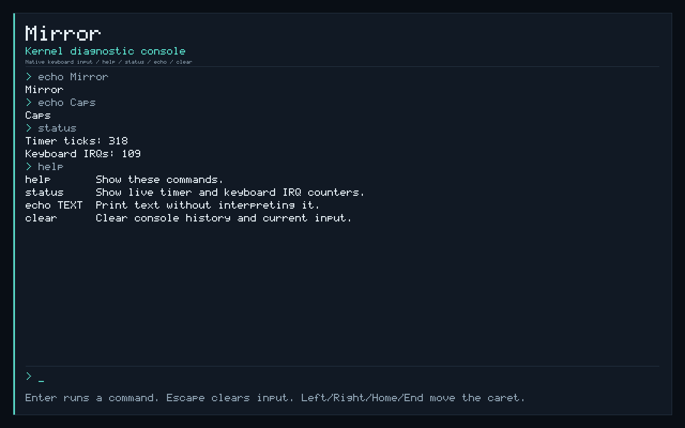

# Mirror

Mirror is an independent operating system being built around a new Rust kernel and native userspace, designed for people and AI agents to use the same computer efficiently. Mirror owns the system interfaces for processes, memory, scheduling, devices, and native services. Windows and Linux are application compatibility targets: separate compatibility implementations will translate their application interfaces onto Mirror. Other goals are fast and controllable automation and coordination of local inference with the rest of the system.

**Status:** the freestanding Rust kernel boots through UEFI/Limine in QEMU with its own exception descriptors and page tables, reusable physical pages, a 1 MiB kernel heap, and timer interrupts. It preemptively schedules two isolated native Rust processes, with twelve native syscalls, process-local capability handles, bounded message channels, sleeping, yielding, and a coarse per-process timer-interrupt budget. Receive operations can block until a message, endpoint closure, or a timeout; checked user copies preserve permissions and message ownership. Process termination releases handles and private memory. The kernel inventories PCI functions, draws through an optional framebuffer, reads sectors through a selected legacy VirtIO block driver with owned DMA buffers, and adds PS/2 keyboard events and an interactive diagnostic console. A complete desktop, filesystems, broader driver ports, application compatibility, unified resource management, and inference services remain future work. The broader designs below are proposals; performance improvements must be demonstrated with measurements.

**Validation:** formatting, Clippy, all 32 debug/release smoke boots, and both normal keyboard input captures pass. Checks cover native process isolation, IPC and scheduling, sector reads and I/O-error recovery, DMA cleanup, device-absence fallbacks, keyboard decoding and loss recovery, bounded editing, and real key events producing verified commands and framebuffer updates. Validation currently runs in QEMU; physical hardware remains untested.

## Build and boot the kernel

The kernel and native init target `x86_64-unknown-none` using stable Rust (minimum 1.88; developed with 1.96.0). Rustup installs the target and components declared in `rust-toolchain.toml`. Cargo dependencies are locked, and the boot scripts download Limine v12.9.3 from its official release and verify the archive's pinned SHA-256. The Rust protocol bindings are pinned to 0.5.0, which supports stable Rust and Limine base revision 3. `scripts/build.ps1` builds each package with its own linker settings using Rust's bundled linker; no host C linker is required. The workspace defaults to the kernel, so use the script to build and stage both executables.

Init uses the small code model for its low virtual addresses. Its optimized build disables LTO to avoid merging incompatible code-model metadata with Rust's prebuilt `core`; kernel release LTO remains enabled. A dedicated userspace target with a matching rebuilt `core` remains future build-system work.

From the repository root in PowerShell:

```powershell
# Compile the kernel and native init, then stage their UEFI boot files.
.\scripts\build.ps1

# Run formatting, Clippy, 32 smoke cases, and debug/release keyboard input captures.
.\scripts\test.ps1

# Build the smoke-test kernel, boot it, and verify its serial results and exit code.
.\scripts\run.ps1 -Smoke

# Verify the optimized kernel, including LTO.
.\scripts\run.ps1 -Smoke -Release

# Verify fatal exception diagnostics (intentional failures inside the guest).
.\scripts\run.ps1 -Smoke -Fault PageFault
.\scripts\run.ps1 -Smoke -Fault InvalidOpcode

# Verify containment of userspace protection faults.
.\scripts\run.ps1 -Smoke -Fault UserKernelRead
.\scripts\run.ps1 -Smoke -Fault UserCodeWrite
.\scripts\run.ps1 -Smoke -Fault UserNx
.\scripts\run.ps1 -Smoke -Fault UserGuard
.\scripts\run.ps1 -Smoke -Fault UserPrivileged
.\scripts\run.ps1 -Smoke -Fault UserBadStack

# Verify that timer preemption lets a peer finish beside a CPU-bound process.
.\scripts\run.ps1 -Smoke -Fault UserBudget

# Verify that process exit closes its last sender and wakes a blocked receiver.
.\scripts\run.ps1 -Smoke -Fault IpcPeerExit

# Verify receive timeout while the peer keeps the endpoint open, then recovery.
.\scripts\run.ps1 -Smoke -Fault IpcTimeout

# Verify successful serial-only boot with no display device attached.
.\scripts\run.ps1 -Smoke -NoDisplayDevice

# Verify normal boot when no supported legacy test disk is attached.
.\scripts\run.ps1 -Smoke -NoTestDisk

# Verify boot with the PS/2 controller removed and its IRQ left masked.
.\scripts\run.ps1 -Smoke -NoKeyboard

# Inject one backend read error; require preserved output and a successful retry.
.\scripts\run.ps1 -Smoke -Fault BlockIoError

# Boot normally; native processes finish before the keyboard console. Ctrl+C stops QEMU.
.\scripts\run.ps1

# Open Mirror's native keyboard console in a QEMU window, with serial diagnostics.
.\scripts\run.ps1 -Graphical

# Boot, type/edit console commands through PS/2, capture PNGs, and close QEMU.
.\scripts\capture.ps1
.\scripts\capture.ps1 -Release
```

Running requires `qemu-system-x86_64.exe` and a matching pair of EDK II/OVMF firmware files. The runner checks `.tools/qemu/`, then PATH; alternatively pass `-QemuPath`, `-FirmwareCode`, and `-FirmwareVars`, or set `QEMU_PATH`, `OVMF_CODE`, and `OVMF_VARS`. QEMU's bundled `edk2-x86_64-code.fd` pairs with `edk2-i386-vars.fd`. Obtain Windows builds through the [official QEMU download page](https://www.qemu.org/download/#windows); QEMU is a local development prerequisite, not a checked-in dependency.

The PNG capture test requires QEMU 7.1 or newer with PNG screendump support; development uses QEMU 11.1. After checking native process completion, block reads, and DMA cleanup, the capture script waits for the console prompt. It uses [QMP input-send-event](https://www.qemu.org/docs/master/interop/qemu-qmp-ref.html#command-input-send-event) to send explicit key presses and releases through the emulated keyboard. Tests exercise overlapping Shift keys, Caps Lock, ignored Ctrl/Alt text, Escape, and cursor/backspace/delete editing, requiring exact submitted commands and redraw markers with nonzero IRQ1 counts. [QMP screendump](https://www.qemu.org/docs/master/interop/qemu-qmp-ref.html#command-screendump) captures the initial prompt and edited results; their PNG signatures must be valid and their hashes must differ. The script then requests a clean QEMU exit. It retains `build/normal-boot.png`, `build/normal-console.png`, and `build/normal-boot.{serial,stderr}.log`. Capture runs without a visible window. `-Graphical` opens a window for a normal run; it cannot be combined with `-Smoke` or `-NoDisplayDevice`.

`build/esp/` contains `EFI/BOOT/BOOTX64.EFI`, `limine.conf`, `kernel.elf`, and `init.elf`. Limine supplies `init.elf` as a boot module for Mirror's ELF loader. QEMU exposes this directory as a read-only virtual FAT boot disk through a modern-only VirtIO device, which Mirror's initial legacy driver does not claim. A separate 1 MiB legacy VirtIO test disk is attached by default; `-NoTestDisk` omits it and cannot be combined with `-Fault BlockIoError`. The scripts do not format physical disks. Firmware variables are copied into `build/` before use. `.tools/`, `build/`, and `target/` are ignored by Git. This produces an EFI boot tree, not an installer or standalone disk image.

The smoke test has a 30-second boot timeout. It checks frame ownership, alignment, reuse, rejected invalid frees, physical-page contents, returning breakpoints, and mapping/unmapping. Heap checks cover mixed layouts, data preservation, exhaustion, hole reuse/coalescing, rejected oversized layouts, and actual `Box`/`Vec` allocation without leaks. Timer checks require repeated hardware IRQ delivery and acknowledgement. A separate allocation loop requires timer progress while verifying that the heap lock restores enabled interrupts.

Userspace checks cover private page-table permissions and reclamation, bounded ELF validation, rollback after a partially completed load fails, ring-3 execution, initialized data and zeroed BSS, stack writes, rejected syscall pointers and unknown calls, preserved registers, and timer progress while user code runs. Copy tests cross noncontiguous physical pages and require unchanged destination bytes when a later page is absent or read-only. Two instances of init are loaded simultaneously into distinct address spaces. Scheduler checks require repeated dispatch of both processes, yielding, sleeping, resumption, preservation of private data identified by each PID, and complete frame reclamation. PID-specific register canaries and the direction flag are checked across yield; finite arithmetic loops check registers and carry-dependent results while actual timer preemption occurs. Sleep and receive-wait tests check that blocked or idle time does not increase user tick charges; deadline checks cover counter wraparound.

Capability checks cover missing, stale, and foreign handles; denied operations; restricted duplicates; zero-rights handles; table exhaustion; and token exhaustion without reuse. Queue checks cover capacity, FIFO wraparound, message preservation, endpoint reference counts, and scrubbing after the last receiver closes. The native processes exchange three messages, verify that learning a peer's token grants no authority, and recover from short or read-only receive buffers without losing the queued message. Each smoke boot tears down its first pair and launches a fresh normal pair, checking fresh BSS, frame reuse, and complete handle/message cleanup after exit or a contained failure.

Device checks cover PCI address bounds, multifunction enumeration with absent functions, the final bus/slot/function, bridge decoding, missing devices, and bounded inventory overflow. Framebuffer checks use guarded RAM surfaces to exercise the same pixel writer: RGB24/BGR32 encoding, padded rows, clipped and extreme rectangles, text and progress rendering, tiny displays, invalid dimensions/masks/pitch, null and noncanonical addresses, and arithmetic overflow. Guard bytes and row padding must stay unchanged.

Contiguous-allocation checks cover fragmented regions, mixed recycled/never-used pages, the 4 GiB boundary, exhaustion without partial reservation, rejected partial releases, and ordinary allocations skipping live DMA reservations. DMA tests exercise real zeroed RAM, distinct three-page and one-page buffers, checked direct-map rollback, bounded access, and complete frame reclamation. Block checks cover queue layout, descriptor bounds, sector/capacity validation, and completion validation. Fixture reads verify selected sectors and enough requests to cross the queue's ring-slot boundary twice; invalid LBAs must leave the caller's buffer unchanged.

The runner requires `MIRROR_USER_PAGING_OK`, `MIRROR_ELF_TESTS_OK`, `MIRROR_USER_LOAD_ROLLBACK_OK`, `MIRROR_USERSPACE_OK`, `MIRROR_USER_CLEANUP_OK`, `MIRROR_SCHEDULER_OK`, `MIRROR_CAPABILITY_TESTS_OK`, `MIRROR_IPC_TESTS_OK`, and `MIRROR_IPC_OK` along with the earlier subsystem markers. The scheduler marker reports process, switch, yield, sleep, preemption, and idle-tick counts; the IPC marker reports messages, waits, timeouts, and handle reclamation. Nonfatal cases finish with the expected kernel page-fault probe, `MIRROR_PAGE_FAULT_OK`, `MIRROR_BOOT_OK`, and QEMU exit status 33.

Every smoke case also requires `MIRROR_PCI_TESTS_OK`, `MIRROR_PCI_READY`, and `MIRROR_FRAMEBUFFER_TESTS_OK`, including detection of the runner's VirtIO boot disk. Display cases require a PCI display function plus `MIRROR_FRAMEBUFFER_READY` and `MIRROR_FRAMEBUFFER_PRESENTED`. `-NoDisplayDevice` removes the emulated display and instead requires zero PCI display functions and `MIRROR_FRAMEBUFFER_SKIPPED reason=missing`, while completing the ordinary userspace and cleanup checks.

Storage checks require `MIRROR_CONTIGUOUS_TESTS_OK`, `MIRROR_DMA_TESTS_OK`, and `MIRROR_BLOCK_TESTS_OK`. With the fixture attached, `MIRROR_BLOCK_READY`, `MIRROR_BLOCK_READ_OK`, and `MIRROR_BLOCK_CLEANUP_OK` must confirm initialization, verified reads, and frame reclamation after reset. `-NoTestDisk` instead requires `MIRROR_BLOCK_SKIPPED` and rejects unexpected device binding. A `MIRROR_BLOCK_FAILED` diagnostic fails the smoke run.

`-Fault PageFault` and `-Fault InvalidOpcode` select intentional unexpected exceptions through the smoke kernel's boot command line. These cases require the matching exception vector, error code, page-fault address where applicable, and QEMU exit status 35. A panic, timeout, or ordinary successful boot cannot satisfy them. The normal kernel excludes these fault triggers and QEMU exit-port writes.

The five user-fault modes attempt to read supervisor kernel memory, write an RX code page, execute an NX stack page, read a stack guard page, and execute privileged `CLI`. The kernel checks the expected exception vector, error code, and fault address where applicable before reporting `MIRROR_USER_FAULT_CONTAINED`. Each case must recover to the scheduler, allow the peer process to finish, reclaim both processes, and launch a normal pair successfully; a fatal guest exception cannot satisfy these tests.

`-Fault UserBadStack` supplies a noncanonical user stack pointer. The return validator must reject it before IRET, report `MIRROR_USER_RETURN_REJECTED`, and complete the same cleanup and relaunch path without a hardware-fault marker. It also requires QEMU exit status 33.

`-Fault UserBudget` finishes the ordinary user checks, then enters an infinite CPU loop. Timer interrupts must preempt it, its peer must complete before its budget expires, and the kernel must terminate the loop after 32 timer interrupts charged to that process. This requires `MIRROR_USER_BUDGET_CONTAINED`, full cleanup and relaunch, and QEMU exit status 33. A hardware-fault marker cannot satisfy the budget test; an unexpected budget marker fails every other scenario.

`-Fault IpcPeerExit` leaves a duplicate sender open until its owning process exits. Teardown must release that final endpoint reference and wake the peer's blocked receive with the closed-channel result, reported by `MIRROR_IPC_PEER_CLOSED_OK`. `-Fault IpcTimeout` keeps the sender open while its owner sleeps for 110 ticks; the peer must observe exactly one 100-tick receive timeout and then recover when the sender closes, reported by `MIRROR_IPC_TIMEOUT_OK`. Both cases require ordinary process completion, cleanup and relaunch, and QEMU exit status 33. Hardware faults or a scenario marker in the wrong test fail validation.

`-Fault BlockIoError` uses [QEMU's blkdebug backend](https://www.qemu.org/docs/master/devel/testing/blkdebug.html) to inject one EIO on a read overlapping sector 1234 of the fixture. The driver must report the I/O error without changing the caller's buffer, then successfully retry and verify that sector. This requires `MIRROR_BLOCK_IO_ERROR_OK retry=1 output_preserved=1`, ordinary process completion and storage cleanup, and QEMU exit status 33. Other cases reject that marker. Smoke and capture tests also check that the fixture's SHA-256 is unchanged after QEMU exits.

Serial and QEMU diagnostic logs are saved under `build/`. `scripts/test.ps1` runs the thirteen fault/normal cases plus no-display, no-test-disk, and no-keyboard cases in debug with 128 MiB and release with 256 MiB, for 32 smoke boots. Each profile also builds a normal kernel and runs the keyboard input/capture checks. Logs and screenshots are retained under `build/test-logs/`; the suite ends by staging a normal debug kernel and init. Build, run, test, and capture commands should run one at a time because they share the staged files.

The current kernel runs one CPU. Its GDT, TSS, 32 exception gates, 16 legacy IRQ gates, a user-callable `INT 0x80` gate, and dedicated double-fault stack are installed before interrupts are enabled. Ring-3 entries use a dedicated kernel stack through TSS.RSP0. The QEMU q35 timer uses the legacy PIC/PIT at approximately 100 Hz. IRQ0 is unmasked first; its handler increments a counter and acknowledges the interrupt without allocation, logging, or locking. Successful keyboard initialization also unmasks IRQ1, whose handler drains the controller before PIC acknowledgement. Timer IRQs delivered during user execution also charge that process's budget and can save its context for another process to run; keyboard IRQs do not charge or schedule processes. The scheduler idles with interrupts enabled when all unfinished processes are sleeping or waiting to receive. After both processes exit, normal boots consume keyboard events in the kernel console; its idle path continues waking on IRQs. Boots without a supported keyboard retain the ordinary idle loop. Ticks measure delivered interrupts, not calibrated elapsed time; long critical sections can lose ticks. APIC/IOAPIC support and broader hardware discovery remain future work.

Paging ownership is established by deep-copying Limine's four-level hierarchy, retaining existing mappings and huge-page leaves, and switching CR3. New heap and scratch mappings are supervisor-only, writable, and non-executable; unmapping invalidates the local TLB. NX and supervisor write protection are enabled. Each user address space owns its lower-half mappings and page tables while sharing supervisor-only upper-half kernel mappings. User text is RX, constants are read-only/NX, and data and stack pages are writable/NX; writable/executable user mappings are rejected. The user-fault suite exercises these restrictions. Existing kernel aliases remain, so user W^X does not establish complete kernel memory protection. Double-fault stack installation is still untested with an induced double fault. Five-level paging is explicitly rejected for now.

Physical allocation begins with a bump allocator, then tracks usable pages with a dynamically sized two-bit bitmap. Previously allocated page tables remain tracked, bitmap pages stay reserved, and released pages can be reused. Metadata currently needs one contiguous usable span. Freeing a page requires ending its uses and withdrawing non-direct-map aliases first; checks reject reserved, misaligned, never-allocated, metadata, and already-free pages. They cannot detect a stale ownership claim after a page has been reallocated. The bootstrap stack and boot responses still belong to Limine, so bootloader memory remains reserved.

The fixed 1 MiB heap has unmapped guard pages and uses `linked_list_allocator` 0.10.6 with an interrupt-state-preserving lock. Blocks are reused and coalesced; heap backing pages stay mapped. Unsupported sizes/alignments return allocation failure before entering the dependency. Interrupt, exception, and syscall handlers must not allocate. The scheduler restores the kernel root before closing a finished process's remaining handles and checking peer wakeups. After both processes finish, it releases their private user trees, including mapped frames and page-table frames, and checks that channel references and messages are gone. Kernel page-table reclamation, heap growth, bounded allocation latency, and a general device framework remain future work.

### PCI inventory and boot framebuffer

The PCI inventory in [kernel/src/pci.rs](kernel/src/pci.rs) reads firmware-configured segment 0 through x86 configuration mechanism 1. Each CF8/CFC address/read transaction preserves the caller's interrupt state on the single boot CPU. Scanning is bounded by 65,536 function addresses and 262,144 configuration reads; the first 32 functions are retained and logged, with full counts and an omitted count. The inventory records identifiers, class, revision, header type, and type-1 bridge bus numbers. It recognizes VirtIO block and GPU identifiers defined by the [Virtio 1.2 specification](https://docs.oasis-open.org/virtio/virtio/v1.2/virtio-v1.2.html).

Discovery writes only the host's configuration-address selector; it does not write device configuration, size or assign BARs, enable bus mastering, or start DMA or device IRQs. A separate exclusive legacy-block claim validates the selected function, its assigned I/O BAR, and its conventional capability list before permitting driver-controlled command-register changes. ECAM, extended configuration, additional PCI segments, hotplug synchronization, and general driver binding remain future work. Firmware and Limine still load the kernel and init from the modern-only boot disk; Mirror's initial storage driver reads the separate legacy device described below.

The boot display in [kernel/src/framebuffer.rs](kernel/src/framebuffer.rs) accepts the first Limine framebuffer when it supplies RGB24 or RGB32 pixels with three disjoint eight-bit color masks. It validates dimensions, pitch, masks, address arithmetic, and canonical addresses before drawing; dimensions are capped at 8192 each and the surface at 128 MiB. Missing or unsupported framebuffers produce a serial diagnostic and boot continues. The renderer respects row padding, clips drawing to the surface, and uses aligned volatile 32-bit stores for RGB32 when possible and volatile byte stores for other layouts, without allocating a backbuffer or reading uninitialized video memory.

Limine supplies the virtual address with the direct-map offset already applied. Mirror preserves its mapping and cache attributes when taking ownership of paging, reserves the framebuffer and boot-response memory, and keeps the mapping supervisor-only in user address spaces. One local driver exclusively owns drawing; interrupt handlers and user processes do not access the surface. These assumptions follow the [Limine protocol's handoff and framebuffer contracts](https://github.com/limine-bootloader/limine-protocol/blob/trunk/PROTOCOL.md#framebuffer-feature).

The boot panel shows Mirror's identity, usable memory reported at boot, and status updated after the native tasks complete. Normal boots then show an interactive diagnostic console when the keyboard is available. Rendering preserves the boot-selected display mode; GPU acceleration, mode switching, application surfaces, a compositor, and window management remain future work. The full native desktop acceptance criteria appear below.


QEMU capture of the boot panel. Normal boots now continue into the keyboard console below; the planned desktop environment remains to be implemented.

### Keyboard input and diagnostic console

[kernel/src/keyboard.rs](kernel/src/keyboard.rs) implements the selected q35 platform's i8042 keyboard path. Initialization disables translation, selects and verifies PS/2 scan-code set 2, and enables IRQ1 only after controller and keyboard checks succeed. Polling, command retries, and initial output draining are bounded. A missing or unresponsive controller leaves IRQ1 masked and the rest of boot available. This is a fixed platform driver; ACPI discovery, USB keyboards, mouse input, hotplug, and physical-PC validation remain future work. The protocol is checked against [QEMU's controller and keyboard implementations](https://github.com/qemu/qemu/tree/v10.1.0/hw/input).

The IRQ handler performs at most 32 byte reads, decodes make/break and extended sequences, and enqueues typed key events in a 64-event queue without allocation, printing, or rendering. Main-context consumers continue bounded draining after a long burst, with the PIT providing wakeups when another keyboard edge does not arrive. Events retain press/release, repeat, and modifier state. Left and right Shift/Control/Alt are tracked independently; Caps Lock changes only on a fresh press. Pause and PrintScreen sequences cannot introduce fake modifiers. Unknown keys are ignored. Corrupt input or queue overflow clears queued events and held state, reports input loss, and suppresses makes until a complete known-key release; release and press again to resume. The console discards its unfinished line before accepting recovered input.

After the two native init processes finish, normal boots run the allocation-free [kernel console](kernel/src/console.rs). `help` lists commands, `status` reports live PIT ticks and keyboard IRQ deliveries, `echo TEXT` prints literal text, and `clear` clears console history. A 96-character ASCII editor supports Left/Right, Home/End, Backspace/Delete, and Escape; 12 bounded history rows retain results. Text entry preserves case and punctuation. Editing redraws only the prompt and notice; submitted commands refresh the history area without repainting the static header. Human commands parse into the same typed `Operation` dispatcher that changes console state; this is an internal interface, not an exposed agent API. The event loop renders with interrupts enabled and checks for work with interrupts disabled before `sti; hlt; cli`, keeping IRQ work separate from drawing and avoiding a lost wakeup.

This diagnostic console runs in kernel context. It does not launch applications, interpret shell syntax, or access files. Userspace input capabilities, focus routing, pointer support, application surfaces, and the full native desktop are still planned. No model or cloud account is needed to type and use the console.

Smoke tests require `MIRROR_KEYBOARD_TESTS_OK` and `MIRROR_CONSOLE_TESTS_OK`, covering decoding, modifiers, repeats, queue wraparound/overflow, corruption recovery, editing bounds, and typed dispatch. Normal device cases require `MIRROR_KEYBOARD_READY`; `-NoKeyboard` removes the controller with `q35,i8042=off,vmport=off` and requires `MIRROR_KEYBOARD_SKIPPED`. Debug and release normal captures then verify the actual QMP-to-PS/2-to-IRQ-to-console-to-framebuffer path.



QEMU framebuffer captured after keyboard editing and diagnostic commands. This is the running kernel console; application windows and desktop services remain future work.

### Read-only block driver and DMA

The initial storage path in [kernel/src/block.rs](kernel/src/block.rs) targets a selected legacy VirtIO block device through its PIO transport registers and a DMA-backed split virtqueue. It issues synchronous, single-sector 512-byte reads through Mirror's own driver. The legacy PCI claim selects the first matching `1af4:1001` type-0 function among the 32 retained inventory entries, checks a firmware-assigned I/O BAR, and rejects enabled MSI/MSI-X or malformed capability lists. The driver owns reset, feature negotiation, queue setup, bus-master enablement, polling, and shutdown; it suppresses device interrupt delivery. See the [Virtio 1.2 legacy PCI and block-device contracts](https://docs.oasis-open.org/virtio/virtio/v1.2/virtio-v1.2.html).

Only queue 0 is used, with one request in flight and an offered power-of-two queue size from 4 through 256. The driver accepts the read-only feature when offered and emits only read requests regardless of device write capability. Request polling is capped at 5,000,000 iterations, reset polling at 100,000, and capacity sampling at eight repeated comparisons; these are work bounds, not calibrated time limits. Completion must advance the used index once, return the submitted descriptor head, and supply a valid status before data reaches the caller. I/O-error and unsupported-request completions preserve output and permit another request. Protocol errors or timeouts stop the queue and require reset.

DMA ownership is implemented in [kernel/src/dma.rs](kernel/src/dma.rs) over the real [frame allocator](kernel/src/memory.rs). Each buffer holds 1–4 consecutive pages from one usable region, wholly below 4 GiB. Allocation reserves a complete free run atomically, validates the direct-map range, and zeroes the pages before the driver publishes them. The block path uses two or three queue pages, depending on queue size, plus one request/data/status page. Raw device-shared fields require volatile access and driver-managed ordering. Buffers have no automatic freeing: the device must be reset and quiescent before the allocator releases them. If reset cannot be confirmed, the claim and DMA pages remain quarantined; disabling bus mastering alone is not treated as proof that outstanding DMA ended.

The disposable fixture at `build/block-test.img` is generated and hash-checked by [scripts/common.ps1](scripts/common.ps1). It contains 2048 sectors, totaling 1 MiB. Each sector begins with its little-endian 64-bit LBA, then the eight bytes `MIRROR\0\x01`; bytes at offsets `i = 16..511` contain `((lba * 73) ^ (lba >> 8) ^ (i * 29) ^ 0xa5) & 0xff`. The host backend is read-only. Boot checks in [kernel/src/main.rs](kernel/src/main.rs) identify this exact fixture before running extended data checks; other supported disks receive only a sector-zero identification read. The kernel checks frame counts after successful driver shutdown.

This milestone provides a kernel sector-read path. It does not implement writes, a filesystem, partition mounting, storage pooling, native storage syscalls, or loading applications from a Mirror filesystem. Modern VirtIO transport, general device selection, concurrent requests, interrupt-driven completion, hotplug, and IOMMU isolation remain future work. Missing supported devices leave the serial diagnostics and native userspace boot path available.

### Native userspace and syscall ABI

The loader accepts a bounded subset of static x86-64 ELF `ET_EXEC` images: at most 16 program headers and 2 MiB of mapped image pages, with aligned, readable, non-overlapping segments. It validates the image before mapping segments, copies file data into fresh zeroed pages, and leaves the remainder zeroed for BSS. Dynamic linking and a general Linux or Windows ABI are not implemented. The first application is [userspace/init/src/main.rs](userspace/init/src/main.rs), built with its [own linker script](userspace/init/linker.ld). It runs on a 64 KiB user stack with an unmapped guard page at each end.

The initial native ABI uses `INT 0x80`: RAX holds the call number, RDI/RSI/RDX hold arguments, and RAX returns the result. Returning calls preserve the other general-purpose registers. Negative results are signed error codes. This is Mirror's native interface; matching an interrupt number does not imply Linux ABI compatibility.

| Call | Arguments | Result |
| --- | --- | --- |
| `WRITE` (1) | RDI = user buffer address; RSI = byte length; RDX = console handle. | Requires console `WRITE` authority. Writes UTF-8 diagnostics with a `user:` prefix and escaped controls; returns bytes accepted. Maximum 256 bytes. After checking the handle, a zero length returns 0 without accessing the pointer; invalid user memory returns -14; oversized input or invalid UTF-8 returns -22. |
| `TICKS` (2) | None. | Current delivered timer-interrupt count. |
| `EXIT` (3) | RDI = exit status. | Returns control to the kernel and ends this process; does not resume user code. |
| `YIELD` (4) | None. | Makes the process runnable and returns 0 when the scheduler resumes it. |
| `SLEEP` (5) | RDI = number of timer ticks. | Sleeps for the requested ticks and returns 0 on resumption. Zero acts as a yield; more than 1000 returns -22. |
| `PID` (6) | None. | This process's positive identifier. |
| `BOOT_HANDLE` (7) | RDI = bootstrap slot: 0 console, 1 outbound sender, 2 inbound receiver. | Returns the existing handle if still open. An invalid slot or a closed original handle returns -9; this call does not mint replacement authority. |
| `SEND` (8) | RDI = channel handle; RSI = readable user buffer; RDX = byte length. | Requires `SEND`. Enqueues one complete message of 1–64 bytes and returns its length. Nonblocking: a full queue returns -11, and no remaining receiver returns -32. |
| `RECV` (9) | RDI = channel handle; RSI = writable user buffer; RDX = capacity. | Requires `RECEIVE`. Copies and removes one complete message, returning its length. Capacity must be 1–64; an empty open queue returns -11 and an empty queue with no senders returns -32. |
| `RECV_WAIT` (10) | Same as `RECV`. | Receives immediately if possible, otherwise suspends the process for up to a fixed 100 delivered timer ticks. Returns -110 if the queue remains empty and open at the deadline check. |
| `CLOSE` (11) | RDI = handle. | Removes this handle and releases its endpoint authority; returns 0. Invalid, stale, or foreign handles return -9. Other duplicates remain valid. |
| `DUP` (12) | RDI = existing handle; RSI = requested rights mask. | Creates a new handle with the same or fewer rights. Returns the new positive token; zero rights creates an inert handle. Adding rights is denied. |
| Unknown call | Any. | -38. |

Capability operations resolve the caller's handle and required rights before accessing the resource. Error results are:

| Result | Meaning |
| --- | --- |
| -9 | Missing, closed, stale, or foreign handle; invalid bootstrap slot. |
| -11 | Queue full on send, or empty with live senders on nonblocking receive. |
| -13 | Insufficient rights or the wrong object type. |
| -14 | Invalid user range or missing effective read/write permission. |
| -22 | Invalid ordinary argument, unsupported rights bits, oversized console write, or invalid UTF-8. |
| -24 | Eight-slot handle table full or the monotonic token allocator exhausted. |
| -32 | No receivers remain on send, or no senders remain and the receive queue is empty. |
| -38 | Unknown syscall. |
| -90 | Message length or receive capacity outside 1–64, or the head message exceeds the supplied capacity. |
| -110 | A blocking receive is still empty and open when its deadline is checked. |

The kernel validates an entire user buffer before copying it. It never formats a raw user pointer directly. Receive checks the whole advertised capacity, including effective user and write permissions at every page-table level, even when the queue is empty. It rechecks the handle and destination on wake. A short buffer or failed copy leaves the message queued, and rejected copies leave the destination unchanged. Copies follow each physical page through the direct map, including ranges that cross noncontiguous frames.

Every return to user mode, including an IRQ return, requires canonical lower-half instruction and stack pointers above the null page and the native CPL3 code/data selectors. An invalid context ends the process before IRET. Yield, sleep, blocking receive, timer preemption, exit, budget exhaustion, and ordinary user exceptions return through a trusted kernel continuation. Resumable cases first save the user's interrupt frame, and Rust handlers return normally before IRET resumes the scheduler. It restores the kernel page table before choosing the next process, then activates that process's private root and resumes its saved registers. NMI, double fault, and machine check remain fatal platform/kernel paths.

The scheduler keeps two processes on the boot CPU with one user thread each. A quantum ends after two delivered timer interrupts during that process's user execution, or sooner on yield, sleep, blocking receive, exit, or a fault. Sleeping processes become runnable at their wake tick. A waiting receiver becomes runnable when a message, endpoint closure, or timeout is observed by the scheduler. Readiness or end-of-stream wins over timeout when observed in the same scheduler check. Receive deadlines count delivered timer ticks and do not imply a precise wall-clock bound.

Each process has a 32-interrupt execution budget, charged only when IRQ0 interrupts CPL3. This is a coarse responsiveness guard rather than precise CPU-time accounting: ticks during kernel execution, sleep, or receive waits do not count, and long critical sections or frequent syscalls can undercount execution. No wall-clock runtime limit is implied.

### Capability and channel ownership

Each process has an eight-slot handle table. Handle tokens are positive, globally monotonic for the boot, and never reused; the allocator stops at the signed-result limit. Authority comes from finding the token in the caller's own table. Tokens are not secrets, and learning another process's token through a message does not grant access to its object.

Rights are a bitmask: `SEND = 1`, `RECEIVE = 2`, and console `WRITE = 4`. Bootstrap grants one console writer, one sender to the peer, and one receiver from the peer. `DUP` operates within the same process and can preserve or reduce these rights. A zero-rights duplicate takes a table slot but cannot perform resource operations or regain rights. It holds no channel sender/receiver reference. Closing a handle invalidates that token immediately; closing a bootstrap token also makes that `BOOT_HANDLE` slot fail, even if a duplicate remains open.

The pair has two directional channels with four queued messages each. Messages contain 1–64 copied bytes; a handle number sent in those bytes remains ordinary data and transfers no authority. Queues retain kernel-owned copies rather than pointers into user buffers. A queued message survives the last sender closing and remains receivable; once drained, receive reports -32. Closing the last receiver discards and scrubs any queued messages, and subsequent sends report -32. Endpoint references track every duplicate with the relevant right.

On exit, fault, rejected return context, or budget exhaustion, the scheduler closes all remaining process handles before checking waiting peers. This lets a blocked peer observe closure without waiting for the finished process's memory to be reclaimed. Pair teardown requires both empty handle tables and fully drained channel storage. There is no channel-creation syscall, handle transfer between processes, blocking send, caller-selected receive timeout, or general revocation mechanism yet.

There is also no process-creation syscall, additional thread support, SMP scheduler, or TLS yet. Initial general-purpose registers are cleared except RDI, which contains the test scenario in its low byte and the process role in its next byte; FS/GS bases are cleared. The integer-only ABI sets CR0.TS during user execution so x87/SIMD use faults until extended-state management is implemented. These limits apply to the current executable milestone, while the architecture below describes the intended broader system.

Kernel entry is in [kernel/src/main.rs](kernel/src/main.rs), boot requests in [kernel/src/boot.rs](kernel/src/boot.rs), physical allocation in [kernel/src/memory.rs](kernel/src/memory.rs), paging in [kernel/src/paging.rs](kernel/src/paging.rs), and exception handling in [kernel/src/interrupts.rs](kernel/src/interrupts.rs). User transitions are in [kernel/src/userspace_entry.S](kernel/src/userspace_entry.S), ELF validation in [kernel/src/elf.rs](kernel/src/elf.rs), and process loading, scheduling, syscalls, and cleanup in [kernel/src/userspace.rs](kernel/src/userspace.rs). Handle tables are in [kernel/src/capability.rs](kernel/src/capability.rs), channel queues in [kernel/src/ipc.rs](kernel/src/ipc.rs), the heap in [kernel/src/heap.rs](kernel/src/heap.rs), and the first timer driver in [kernel/src/timer.rs](kernel/src/timer.rs). See Rust's [bare-metal target documentation](https://doc.rust-lang.org/rustc/platform-support/x86_64-unknown-none.html) and the [Limine bootloader](https://github.com/Limine-Bootloader/Limine) for the underlying build and handoff contracts.

## Goals

- A complete native desktop environment with responsive manual controls, typed agent interfaces, a small baseline resource footprint, and optional background services.
- Independent Windows and Linux application compatibility implementations over Mirror's native kernel and services, expanded through a published, tested application matrix.
- Structured application operations that agents can discover and invoke without repeatedly interpreting screenshots.
- OS-enforced limits on agent access to files, processes, networks, devices, credentials, and compute.
- A common resource policy for RAM, VRAM, storage, and cache locality, aware of the differences between them.
- Local inference that cooperates with interactive applications over memory, compute, bandwidth, power, and scheduling.
- Storage pooling that uses available devices and transfer paths while maintaining explicit durability guarantees.

Rust is the primary implementation language. Existing compatibility and inference components may use other languages. Language choice alone does not establish speed, isolation, or compatibility.

## Proposed architecture

Mirror's foundation is its own Rust kernel and native userspace. That work is already executable: the kernel boots on virtual hardware in QEMU and schedules native Rust programs through Mirror's syscall interface. Native init, services, the device framework, and future desktop use Mirror interfaces. Resource policies and inference services will build on those same memory, scheduling, and device mechanisms.

Two separate application compatibility personalities are planned. A personality implements the interfaces expected by applications from another operating system and translates their behavior onto Mirror's native primitives. The Windows personality targets Windows executables and APIs; the Linux personality targets Linux executables and its syscall ABI. Neither personality defines Mirror's kernel or native system services, and implementing the Windows personality does not depend on adopting Linux as a system base.

| Component | Responsibility |
| --- | --- |
| Mirror kernel | New Rust implementations of address spaces, threads, scheduling mechanisms, interrupts, memory mappings, IPC, capability enforcement, and device isolation where hardware supports it. |
| Native system services | Mirror filesystems, networking, device management, application lifecycle, and desktop services using native Mirror interfaces. Place services outside the kernel where practical. |
| Native desktop | Mirror's compositor, window management, input routing, application launcher, taskbar, settings, file manager, and notifications, with complete human controls and capability-checked agent operations. |
| Agent broker | Discover typed operations, validate arguments and authority, apply quotas, dispatch actions, and record results. |
| Capacity manager | Account for resources, choose object placement, reserve transfers, and coordinate reclamation and prefetching. |
| Inference services | Execute models through replaceable backends and supply workload hints to the capacity manager and scheduler. |
| Storage service | Manage a logical pool, extent placement, checksums, redundancy, recovery, and background rebalancing. |
| Windows application personality | Load Windows PE executables and supply the Windows APIs and NT behavior required by selected applications, using Mirror's native kernel and services. |
| Linux application personality | Load Linux ELF applications and implement their required syscall and userspace ABI behavior over Mirror's native kernel and services. |

The kernel supplies bounded mechanisms and enforces authority. Higher-level resource policy and model execution belong in restartable services. A model crash or unavailable cloud provider must not stop the machine from booting or being used manually.

Initial development target: **x86-64, UEFI, and QEMU**, using Limine for the boot handoff, followed by a deliberately small hardware support list. QEMU provides a repeatable machine to boot the actual Mirror kernel. GPU and target-application requirements will guide the first physical hardware targets.

## Native desktop environment

Mirror will have a complete native desktop environment built on its own kernel, drivers, and userspace services. The desktop must be usable manually with a keyboard and pointer, including when no model is loaded or cloud account is available. Every desktop feature must also be designed for typed, capability-checked agent access through the same underlying operations and state changes used by the human interface.

The planned scope and completion criteria are:

| Area | Native implementation and acceptance evidence |
| --- | --- |
| Compositor and windows | Compose surfaces from real native applications; open multiple independent windows, move and resize them, change focus, minimize, maximize, and close them. Rendering and repainting must reflect live application state. |
| Input | Route keyboard and pointer events through Mirror's device and input services to the focused surface; verify text entry, selection, pointer actions, and desktop shortcuts across application switches. |
| Application launcher and taskbar | Launch installed native applications, display running applications and their windows, switch or restore them, and reflect their actual exit state. |
| Settings | Provide working display, input, appearance, resource, and permission controls backed by the corresponding services; persist supported settings and verify them after reboot. |
| Files | Browse the real filesystem, open files in applications, and create, rename, move, copy, and delete permitted objects; verify durable results and reject operations outside the caller's authority. |
| Notifications | Deliver notifications from applications and services, show their source and actions, and support dismissal and notification preferences through both interfaces. |
| Human and agent operation | Complete the same representative desktop workflows manually and through typed operations; verify consistent results, change events, permission denials, and continued manual use when inference is unavailable. |

Desktop acceptance requires these features to work together on a documented supported machine with Mirror's actual rendering, input, application, and storage paths. Record responsiveness under application and inference load once those backends exist. Boot framebuffer output establishes early display access; it does not demonstrate a compositor, working controls, or a completed desktop. The full desktop remains planned, and the verified kernel/userspace milestone above does not claim these features are implemented.

## AI as a first-class system interface

Mirror applications should expose versioned, typed operations alongside their human interface. An operation describes its inputs, outputs, required capabilities, side effects, cancellation behavior, and retry semantics. For example, an editor could expose `document.open`, `document.replace_range`, and `document.save`, returning structured results and change events.

Agents can inspect state, subscribe to changes, and batch supported operations instead of repeatedly capturing a screen, guessing a coordinate, and waiting. This should reduce interaction overhead; it does not eliminate model latency or make legacy applications automatically expose useful APIs.

Use native application APIs first, compatibility adapters and accessibility interfaces second, and visual interaction where necessary. Human and agent interfaces should invoke the same underlying application operations so behavior stays consistent.

### Authority and isolation

- Give each agent a separate principal and scoped, revocable capabilities. Scope can include an object or directory, an allowed operation, a network destination, a lifetime, and resource limits.
- Enforce grants at the underlying resource boundary. Broker checks alone are insufficient if an agent can bypass them through a shell, direct filesystem access, IPC, or an unrestricted application.
- Use kernel-managed handles and constrained delegation. Child processes and invoked applications must not gain broader authority merely by acting for an agent.
- Bind authorization to the actual object and operation, including when names or paths change between inspection and execution.
- Keep credentials in a dedicated broker. Ordinary application automation and model context should not receive raw provider tokens.
- Support previews and explicit grants for consequential operations, cancellation, and compensating actions where possible. Do not claim every action is reversible.
- Record the requesting principal, granted authority, affected resource, and outcome. Redact secrets and restrict access to audit records.
- Apply the same resource limits to local and remote agents. Treat application content, tool results, and retrieved text as data that cannot mint capabilities.

These controls limit what a compromised or misdirected agent can do. They do not establish that a model is always correct or immune to prompt injection. Compatibility applications and drivers remain part of the isolation design.

### Providers and sign-in

Support local models and interchangeable remote provider adapters. Provider authentication, permission to use inference, and permission to operate Mirror are separate decisions. Local OS login and offline use must remain available without a cloud account.

As checked on October 8, 2026, OpenAI documents Sign in with ChatGPT for open-source/local applications, including optional authorization for eligible Responses API requests using a ChatGPT plan. Identity scopes do not themselves grant inference access or access to conversations. Mirror's adapter must follow the applicable registration, consent, scope, and token-lifecycle requirements; eligibility depends on the integration and account. See the [official overview](https://developers.openai.com/siwc/token-sharing-open-source) and [integration availability](https://developers.openai.com/siwc/quickstart).

Mirror's distribution model and license are still undecided. Select the appropriate provider integration once those are established; do not assume an open-source integration applies to every distribution.

## Windows and Linux applications

Windows `.exe` files and Linux applications are independent execution targets for Mirror. Both will run against compatibility personalities built on Mirror's own kernel and native userspace. Linux application support means implementing the required application ABI; it does not mean using the Linux kernel or a Linux distribution as Mirror's foundation.

Loading an executable is only one part of compatibility. Applications also depend on system calls, libraries, threading, graphics, filesystem behavior, services, and sometimes kernel drivers. Each personality must supply the observable behavior required by its selected applications while preserving Mirror's process isolation and resource controls.

| Application class | Proposed route | Initial boundary |
| --- | --- | --- |
| Native Mirror applications | Rust services and applications using Mirror's own APIs. | Native init is running now; more services build on this environment. |
| Windows user applications | Mirror's Windows personality: PE loading plus the Windows API and NT behavior required by selected applications, implemented over Mirror primitives. | Start with named applications and bounded workflows; loading PE files alone is insufficient. |
| Linux command-line programs | Mirror's Linux personality: ELF loading and a bounded Linux syscall ABI mapped to Mirror primitives. | Start with small static binaries and the calls they actually require. |
| Larger Linux applications | Expand the Linux personality's dynamic loading, libraries, graphics, and service support. | Compatibility is verified per application and version. |
| Applications needing a full guest OS | Investigate optional integrated Linux or Windows VMs later. | Separate from either application personality; requires a virtualization backend, guest integration, suitable hardware, and appropriate guest software licensing. |

For Windows applications, the implementation scope includes executable and DLL loading, imported APIs, and required NT-style object, handle, thread, synchronization, exception, and filesystem behavior. Graphics and platform services follow the needs of the selected workflows. This is incremental application compatibility, with explicit supported behaviors and gaps; it is not a commitment to recreate every Windows subsystem before the first application runs.

For Linux applications, the ELF format and syscall ABI are application contracts to implement on Mirror. Native Mirror programs also use ELF today, but they already have a distinct native syscall interface. [FreeBSD's Linux compatibility documentation](https://docs.freebsd.org/en/books/handbook/linuxemu/) is a precedent for implementing a foreign application ABI on another kernel. POSIX source compatibility alone does not establish Linux binary compatibility.

Existing projects such as [Wine](https://www.winehq.org/about) may offer code worth reusing for particular Windows behaviors. Adopting any of that code requires an explicit later decision about licensing, dependencies, adaptation to Mirror interfaces, and maintainability. A Wine port is not a predetermined architecture or a roadmap acceptance gate. Kernel drivers, anti-cheat, DRM, and applications with deep platform dependencies require separate assessment.

GPU support is an early feasibility gate. For example, Mesa's RADV Vulkan driver depends on the Linux `amdgpu` kernel interface; a Vulkan API alone does not supply the required driver stack. CUDA likewise has supported OS and driver requirements. Mirror will pursue native driver ports for a selected hardware family and adapt the corresponding userspace graphics and compute stack. Accelerated inference is a milestone that depends on that working port. See [Mesa RADV](https://docs.mesa3d.org/drivers/radv.html) and [CUDA system requirements](https://docs.nvidia.com/cuda/cuda-installation-guide-linux/).

Booting Mirror inside QEMU does not give Mirror the ability to host accelerated guest operating systems. That is a separate project; [QEMU's accelerators](https://www.qemu.org/docs/master/system/introduction.html) rely on host facilities.

The first Windows and Linux application targets are still to be selected. Record application versions, dependencies, required workflows, graphics needs, and known failures in the compatibility matrix. Advance each personality against those concrete tests without making universal compatibility claims.

### Native driver ports

Port drivers into Mirror through a documented platform adaptation layer. Reuse device-specific source where licensing permits, and replace its dependencies on the original operating system with Mirror implementations for MMIO, DMA mappings and buffer lifetimes, interrupts, allocation, synchronization, timers, and work queues. Device discovery, power management, firmware loading, and recovery also need explicit integration.

Begin with serial diagnostics and a small set of virtual devices, then establish the device framework and port drivers for named physical hardware. Keep architecture-specific operations and device-independent services separate from device logic so each port has a bounded interface to implement and test. Userspace libraries that expect a particular kernel driver ABI need a matching compatibility interface or their own port.

Porting source does not mean Mirror can directly load Linux kernel modules or closed-source Windows/Linux binary drivers. Existing modules depend on their original kernel's ABI and internal behavior. Each candidate driver requires an assessment of available source, firmware, licensing, hardware documentation, and dependencies before it becomes part of the support plan.

## Unified capacity management

Treat resources as a shared management problem while preserving their individual properties.

| Resource | What Mirror can manage | Constraint |
| --- | --- | --- |
| CPU RAM | Allocations, resident pages, NUMA placement, pinned buffers, and reclaimable data. | Locality, bandwidth, and page ownership matter. |
| GPU VRAM | Runtime-managed buffers, residency, transfers, and supported mappings. | Access, coherence, and migration depend on the GPU and driver. |
| CPU/GPU caches | Locality, working-set behavior, and hardware-supported controls. | Ordinary hardware cache is not an additional independent RAM allocation pool. |
| NVMe, SSD, HDD, UFS, and other storage | Durable objects, staged model data, and spill space. | Persistence, latency, endurance, transfer paths, and failure domains differ. |

Do not report RAM plus VRAM plus disk capacity as a single quantity of equally usable memory. Report capacity and pressure by tier, then explain which workloads can use each tier. [Linux HMM](https://kernel.org/doc/html/latest/mm/hmm.html), [hardware cache resource control](https://docs.kernel.org/filesystems/resctrl.html), and [CUDA Unified Memory](https://docs.nvidia.com/cuda/cuda-programming-guide/04-special-topics/unified-memory.html) are useful precedents with hardware-specific limits.

The capacity manager should understand managed objects such as immutable model weights, active KV-cache blocks, temporary activations, files, and ordinary application pages. Each object needs a size, owner, permitted locations, mutability/coherence rules, current valid copies, durability requirement, eviction/recomputation cost, and optional next-use or deadline hints.

Native inference runtimes can provide these hints explicitly. Arbitrary legacy application memory cannot be assumed to identify tensors or safely move between CPU and GPU execution contexts. Begin with registered buffers and runtime cooperation, then expand general page-management policies.

### Transfer graph and Dijkstra's algorithm

Represent memory and storage locations as graph nodes. Edges represent supported transfers, including staging through RAM when direct transfer is unavailable. Record shared controllers, buses, and links as constraints so multiple transfers cannot each assume the full bandwidth of the same path.

For an object of a fixed size and a snapshot of current load, estimate an edge's nonnegative cost in units of time:

```text
transfer_cost = setup_latency + bytes / effective_bandwidth + queue_delay
```

Filter out paths that violate accessibility, capacity, ownership, or durability requirements. Dijkstra can then choose a minimum estimated cost route for a serialized transfer under that snapshot.

Routing is one part of the policy. Separate decisions choose the destination, decide what to evict or recompute, admit concurrent transfers, and reserve shared resources. Pipelined or parallel transfers require a richer model than summing edge costs. Re-evaluate plans when load changes, with a minimum expected benefit and cooldown to avoid repeatedly moving the same object.

A migration must reserve destination and staging space, synchronize writers, copy and verify data as appropriate, publish the new valid location, and only then release the old allocation. Failed or canceled transfers must release reservations while preserving a valid copy. Durable objects require storage commit semantics in addition to memory-copy correctness.

## Storage pooling

Every enrolled permanent storage device should participate in a logical pool. Device discovery proposes enrollment; enrollment must preserve existing data or explicitly initialize a device selected for that purpose. Merely attaching a drive must not silently overwrite it.

Use checksummed extents with separate policies for placement and durability. Candidate policies include weighted striping for parallel I/O, replicas for read concurrency and resilience, and tiering for active versus cold data. Schedule chunks according to measured device and path behavior so a slow drive does not automatically become part of every latency-sensitive read.

Multiple drives can increase throughput when there is enough parallel work and independent bandwidth. They can also share a controller or upstream link, and adding a slow drive can hurt a particular workload. The topology-aware storage discussion in [NVIDIA's GPUDirect Storage design guide](https://docs.nvidia.com/gpudirect-storage/design-guide/) is a useful reference; direct storage-to-GPU paths require specific platform support.

Proposed initial durability policy:

- Keep irreplaceable data and pool metadata redundant across at least two independent devices when available. Report when that requirement cannot be met.
- Allow explicitly disposable model caches and temporary data to use less redundancy, provided they can be reconstructed.
- Make persistent writes and metadata updates crash-consistent; verify recovery before treating the pool as usable for real data.
- Bound background rebalancing and rebuild traffic, and define degraded operation, device removal, and interruption recovery.

Striping alone provides no redundancy, and a redundant pool does not replace backups. Initial native storage work should use disposable QEMU disk images through Mirror's device drivers. A production filesystem and recovery implementation are later milestones.

## Inference and scheduling

Integrate inference with OS policy through dedicated services. Keep model weights, tokenizers, inference backends, and provider adapters outside the kernel.

The runtime should expose memory estimates and phase information: model loading, prefill, decoding, and background work. The scheduler and capacity manager can use these hints to reserve interactive headroom, cap queue depth and context growth, prefetch likely-needed weights, reclaim inactive objects, and account for shared memory bandwidth and power limits.

Batching can improve throughput while increasing wait time. Moving data out of VRAM can make a model fit while reducing its speed. Both decisions need workload-specific measurements. Inference-aware KV-cache management has useful precedent in the [PagedAttention paper](https://arxiv.org/abs/2309.06180).

CPU scheduling cannot guarantee immediate preemption of an arbitrary GPU workload. Backend support and bounded submissions determine how quickly inference can yield the device. Define admission and responsiveness rules around the capabilities of the actual driver and runtime.

Keep per-user model state isolated. Any sharing of cached prompts or KV data must respect ownership and information-flow policy. The machine must remain responsive when inference runs out of memory, stalls, or crashes.

## Development roadmap

Milestones are acceptance gates, not delivery-date promises. Work proceeds from the kernel to native userspace, then device support and higher-level services. Target applications, hardware, licensing, and reference workloads should be narrowed alongside implementation so they inform interfaces without blocking the first boot.

| Stage | Deliverable | Evidence required to advance |
| --- | --- | --- |
| 1. Kernel boot | Freestanding Rust x86-64 kernel, Limine boot handoff, serial diagnostics, and memory-map inspection. | Buildable EFI boot tree and repeatable QEMU boots; expected serial output; validated handoff data; diagnostic panic and halt paths. |
| 2. Memory and exceptions | Physical frame allocation, virtual memory ownership, kernel allocation, exception handling, interrupts, and timers. | Reserved memory is never allocated; mapping operations preserve ownership; faults produce useful diagnostics; timer interrupts work. |
| 3. Native userspace and syscalls | User address spaces, executable loading, syscall entry, threads, scheduling, IPC, capability handles, and a minimal native init process. | A native user program runs; process faults remain contained; invalid pointers and unauthorized handles are rejected; tasks yield and resume. |
| 4. Device framework and driver ports | Platform adaptation layer, device discovery, display and input foundations, DMA and interrupt support, VirtIO storage/network drivers, and selected physical-device ports. | Named devices work through Mirror's interfaces; display output and input delivery use real device paths; DMA ownership and interrupt handling are checked; failure and device recovery paths are exercised. |
| 5. Native services, application personalities, and AI | Mirror filesystem, shell, and desktop service foundations; initial, separately scoped Windows PE/API/NT and Linux ELF/syscall personalities over Mirror interfaces; typed-operation broker, CPU inference, and capacity-manager integration. | Native services run on Mirror; selected Windows and Linux workflows pass their personality-specific tests as support arrives; agent permissions are enforced; inference preserves interactive headroom. |
| 6. GPU ports and accelerated inference | Selected GPU driver port, userspace graphics/compute integration, real RAM/VRAM placement, and responsiveness controls. | Correct rendering and model outputs on named hardware; reproducible mixed-load measurements; migration and resource-pressure recovery. Assess the port's dependencies during earlier stages. |
| 7. Complete native desktop and durable pool | Native compositor and windows, keyboard/pointer input, application launcher and taskbar, settings, files, and notifications with full human controls and typed agent interfaces; installer/update recovery, storage pooling, expanded compatibility, and broader device testing. | All native desktop acceptance workflows above pass on supported hardware, manually and through authorized agent operations; settings and files survive reboot; recovery after interrupted writes/updates and device failures; application-specific workflows and repeatable permission tests. |

Full guest-OS integration remains a separate later compatibility option. Universal Windows/Linux compatibility, arbitrary hardware support, and a fully optimized inference stack are outside the first milestone.

### First implementation slice

Build the freestanding Rust kernel and its EFI boot tree first. Limine supplies the initial boot environment and memory map; Mirror owns the kernel entry point, serial diagnostics, handoff validation, and panic behavior. This establishes the executable base for physical memory management and exception handling before entering native userspace.

The first boot slice's acceptance criteria are:

1. The kernel builds for a bare-metal x86-64 target without a host operating-system runtime.
2. The EFI boot tree reaches Mirror's entry point under QEMU and emits an identifiable serial boot message.
3. The kernel validates the required boot-protocol revision and memory-map response before inspecting entries; missing required data produces a diagnostic halt.
4. Memory-map accounting and frame allocation distinguish usable memory from reserved regions. Frame recycling, page-table ownership, and the initial heap are implemented; private user trees are reclaimed on process teardown. Bootloader and kernel page-table reclamation remain later work.
5. Panic and normal idle paths remain within Mirror. Fatal paths disable maskable interrupts and halt; normal idle enables them and wakes for timer IRQs.

This original slice establishes boot and handoff behavior. Stage 3 now has isolated native user processes, syscalls, teardown, preemptive scheduling, console/channel capabilities, and bounded IPC. Broader thread and process lifecycle support, capability delegation, and additional IPC mechanisms remain work for that stage. Early stage-4 work adds PCI inventory, optional boot framebuffer output, contiguous DMA ownership, a selected read-only legacy VirtIO block path, and PS/2 keyboard input with a diagnostic console. A general device framework, filesystems, pointer and broader input drivers, and the full native desktop remain ahead. General application compatibility and inference capability remain later milestones.

### Performance evidence

Once real backends exist, record idle RAM and CPU use, boot and application launch time, interactive p95 latency, model load time, time to first token, inter-token latency, tokens per second, peak RAM/VRAM, transferred bytes, storage throughput, and recovery behavior.

Compare the same hardware, application workload, model, quantization, context length, concurrency, and warm/cold-cache conditions. Include both models that fit in VRAM and oversubscribed workloads. Evaluate a static placement baseline as well as existing operating-system/runtime behavior. Report throughput and responsiveness together, including regressions, before claiming Mirror is faster.
